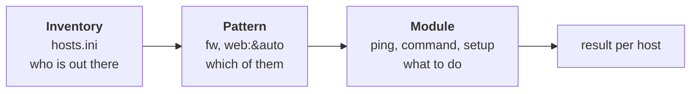

# Lab A1: Orientation with Ansible

In [Lab M1](labM1.md) you logged in to nodes one at a time and asked each a question. That works for one node and gets tiresome at eight. Ansible's answer is to keep **a list of your machines** (the inventory) and let you ask **all of them** at once. In this lab you do the same fact-finding as M1, but with Ansible, and meet its basic vocabulary on the way.

**Part 2: as a playbook, on branch a.** About 10 min. This is the same job you did by hand in [Lab M1](labM1.md).

Your pod number is the number in your login name (`student07` is pod 07). The page fills it in where you see it below; if you still see `@POD@`, use that number.

---

## In this lab

| Command | What it does |
| ------- | ------------ |
| `ansible-inventory --graph` | Show every host Ansible knows and the groups they are in |
| `ansible <pattern> -m <module> -a "<args>"` | Run one **module** on the hosts matching a **pattern** (an *ad-hoc* command) |
| `ansible all -m ansible.builtin.ping` | Test that Ansible can log in to and run Python on every node |
| `ansible-doc <module>` | Read a module's documentation offline |
| `ansible ... -m ansible.builtin.setup -a "filter=..."` | Gather **facts**: details a node reports about itself |

---

## The idea: inventory, patterns, modules

Ansible has three parts you need to know right now:



- The **inventory** (`hosts.ini`) lists the hosts and sorts them into **groups**. Yours has `manual` and `auto` (the two branches) and `pc`, `sw`, `fw`, `web` (the roles). One host can be in several groups: `fw-a-@POD@` is in both `fw` and `auto`.
- A **pattern** picks hosts: a group name (`fw`), `all`, or a combination such as `fw:&auto` (**fw AND auto**, so only the automated branch's firewall) or `web:!manual` (web servers *not* in manual).
- A **module** is a small, tested piece of code that does one job on the target: `ping`, `command`, `copy`, `template`, `iptables`. You almost never write shell by hand in Ansible: you pick the module that does the job and give it arguments.

Ansible runs from your terminal and connects out to each node over SSH. Nothing needs to be installed on the nodes except Python. The login (`root` and the pod password) is already in `group_vars/all.yml`, which is why you are never asked for a password.

---

## 1. Ask what Ansible knows

```sh
cd ~/netlab
ansible-inventory --graph
```

You get a tree: every group, with its hosts underneath. Find your four `-a-` nodes under `@auto` and your four `-m-` nodes under `@manual`.

**Your turn:** which two groups does `web-a-@POD@` appear under, besides `@all`? Check the tree.

<!-- dojo-reveal: Which groups? -->

`@auto` (it is on the automated branch) and `@web` (it is a web server). A host belongs to as many groups as describe it, and that is what makes patterns like `web:&auto` possible.

<!-- /dojo-reveal -->

---

## 2. Ask every node: are you there?

```sh
ansible all -m ansible.builtin.ping
```

Despite the name, this is **not** an ICMP ping. The `ping` module logs in over SSH, finds Python and replies `pong`. A green `SUCCESS` for a node means "Ansible can reach it and run code on it", which is the precondition for everything else. You should see eight hosts. If any says `UNREACHABLE`, the pod is still starting, so wait a minute and try again.

`ansible.builtin.ping` is the module's **fully qualified name**. The short `ping` also works, but the long form says exactly which one you mean and is what the rest of this workshop uses.

---

## 3. Run a command everywhere

```sh
ansible fw -m ansible.builtin.command -a "iptables -S"
```

Read it as: *on hosts matching `fw`, run module `command`, with argument `iptables -S`.* Both firewalls answer (`fw-m-@POD@` and `fw-a-@POD@`), and the output should be the baseline rules you read by hand in M1. One command, two firewalls, no `ssh`.

Now restrict it to your automated branch:

```sh
ansible "fw:&auto" -m ansible.builtin.command -a "ip -br addr"
```

The quotes stop your shell reading `&` as "run in the background". This is the same address list you read on `fw-m-@POD@` by hand.

**Your turn:** the output header says `CHANGED`, yet `iptables -S` changed nothing. Why would Ansible say that? Think about what it can and cannot know.

<!-- dojo-reveal: Why CHANGED? -->

The `command` module has no idea what the command you give it does, so it assumes the worst and reports `CHANGED`. Modules built for a job (`copy`, `iptables`, `template`) know how to check first and report `ok` when nothing needed doing. Making `command` honest, with `changed_when`, is a skill you pick up in Lab A6.

<!-- /dojo-reveal -->

---

## 4. Ask nodes about themselves: facts

```sh
ansible auto -m ansible.builtin.setup -a "filter=ansible_default_ipv4"
```

The `setup` module collects **facts**, details a node knows about itself. `filter=` keeps just the ones you want. For each automated node you get its address, gateway, interface and netmask: the pc is `10.10.10.10` with gateway `10.10.10.1`, the web server `10.10.20.10` with gateway `10.10.20.1`. This is the information you collected by hand with `ip -br addr` and `ip route`, now as structured data you can use in later labs.

---

## 5. Read the documentation without leaving the terminal

```sh
ansible-doc ansible.builtin.ping
```

`ansible-doc` prints a module's description, every argument and examples. It works offline, and **it is how you will learn the other modules**: when a lab says "use `ansible.builtin.template`", `ansible-doc ansible.builtin.template` tells you which arguments exist. Press `q` to leave.

---

## 6. The twist

Get the nginx version from **both** web servers in one command. Use what you have learned: a group pattern, the `command` module, and the same flag you used on the web node by hand in M1 (`nginx -v`).

<!-- dojo-reveal: The answer -->

```sh
ansible web -m ansible.builtin.command -a "nginx -v"
```

`web` matches the web server of both branches. (`nginx -v` writes to the *error* stream, but Ansible shows both.) By hand that was two `ssh` sessions; here it is one line, and it scales to a hundred servers.

<!-- /dojo-reveal -->

---

## Prove it matches

Compare with what you found by hand:

1. `ansible "fw:&auto" -m ansible.builtin.command -a "ip -br addr"` shows the same addresses as `fw-m-@POD@`.
2. The probes do the same job as in M1, this time on branch a:

```sh
ansible-playbook probe.yml -e branch=a -e proto=icmp -e expect=allowed
ansible-playbook probe.yml -e branch=a -e expect=blocked
```

Both should print `PASS`: ping works and HTTP is blocked at the start.

---

## Check your work

```sh
cd ~/netlab
dojo netlab check A1
```

The checker logs in to all eight nodes from outside your terminal. Each line says `PASS` or `FAIL` with the reason. Fix what failed and run it again (the checker allows about six runs a minute).

---

## If you are stuck

| You see | Cause and fix |
| ------- | ------------- |
| `UNREACHABLE` on some nodes | The pod is still starting or a node restarted. Wait a minute and run `ansible-playbook verify_topology.yml` |
| `No inventory was parsed` or `provided hosts list is empty` | You are not in `~/netlab`. `cd ~/netlab` first: that is where `hosts.ini` and `ansible.cfg` live |
| `zsh: no matches found` or odd output with `fw:&auto` | Put the pattern in quotes: `"fw:&auto"` |
| `dojo netlab check` says the checker said no | Too many runs in a minute, or the pod is not up yet: wait and try again |

---

## Recap

- The **inventory** lists hosts and groups; a **pattern** selects them; a **module** does the work.
- `ansible <pattern> -m <module> -a "<args>"` is an **ad-hoc** command: one task, no file.
- `ansible.builtin.ping` tests Ansible's own connection, not the network. `setup` returns **facts**.
- `command` always reports `CHANGED` because it cannot know better; purpose-built modules report honestly.
- `ansible-doc` is your offline manual.

**Next:** [Lab A2](labA2.md): the switch, as code. You will design the data model yourself.
