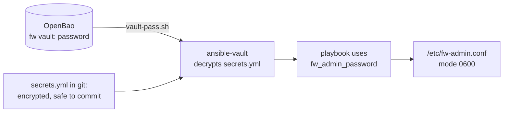

# Lab A10: Secrets with OpenBao (stretch)

Every real system has secrets: passwords, tokens, keys. The question is where they live. In this lab you keep them out of every file you could commit: the passwords sit in **Ansible Vault** (encrypted), and the password *for that vault* sits in **OpenBao**, a secrets server. Two teams each get their own, so one team cannot read the other's.

**Stretch lab, part 2.** Skip it if time is short. About 25 min. It is independent of the other labs: it only needs the pod running.

Your pod number is the number in your login name (`student07` is pod 07). The page fills it in where you see it below; if you still see `@POD@`, use that number. The same starter is in `~/netlab/labs/5-vault/`.

---

## In this lab

| Concept or command | What it does |
| ------------------ | ------------ |
| `bao token lookup` | Show who you are signed in to OpenBao as |
| `bao namespace create` / `bao secrets enable` / `bao kv put` / `bao kv get` | Make a vault, enable key-value storage, store and read a secret |
| `bao policy write` / `bao token create` | Say what a team may read, and give them a token that can only do that |
| `ansible-vault create` / `view` | Create or read an encrypted file |
| `--vault-password-file ./vault-pass.sh` | Get the vault password by running a script |
| `no_log: true` | Keep a task's arguments and results out of the output |

OpenBao plays the part of Azure Key Vault (or HashiCorp Vault), and your login plays Entra ID.

---

## The idea: a secret that unlocks the secrets



An encrypted `secrets.yml` can be committed safely, but it needs a password to open. If that password is also in a file, you have only moved the problem. So the vault password is not in a file at all: a small script asks OpenBao for it each time. The script holds no secret, only the *location* of one, so it is safe to commit too.

Two teams, a **firewall team** and a **switch team**, each get their own repo, their own encrypted file and their own vault in OpenBao. That is the point of the twist at the end.

---

## 1. The problem, by hand

First do it the way most people do. Put a password on the firewall and the switch:

```sh
ssh root@fw-m-@POD@ 'umask 077; echo admin_password=pick-a-password > /etc/fw-admin.conf'
ssh root@sw-m-@POD@ 'umask 077; echo admin_password=pick-another-one > /etc/sw-mgmt.conf'
history | tail -n 3
```

`umask 077` makes the new file readable only by its owner (mode 600). The files are protected on the node, but **look at the last command**: the passwords are now in your shell history, and anything you typed them into. That is the problem to fix.

---

## 2. Be the admin: one vault per team

You administer one OpenBao **namespace**, `students/<you>`: a separate area inside the server. Make a vault for each team inside it:

```sh
bao token lookup
ns=students/$USER
for t in fw sw; do
  bao namespace create -namespace=$ns $t
  bao secrets enable -namespace=$ns/$t -path=secret kv-v2
  bao kv put -namespace=$ns/$t secret/ansible password="$(openssl rand -base64 18)"
  printf 'path "secret/data/ansible" { capabilities = ["read"] }\n' | bao policy write -namespace=$ns/$t $t-team -
done
```

What the loop does, for each team `t`:

| Command | Meaning |
| ------- | ------- |
| `bao namespace create ... $t` | a private vault area, `students/<you>/fw` or `/sw` |
| `bao secrets enable ... kv-v2` | switch on versioned key-value storage at the path `secret` |
| `bao kv put ... password="$(openssl rand -base64 18)"` | store a randomly generated password (nobody, including you, chose it) |
| `bao policy write ... $t-team -` | a **policy**: this team may only `read` `secret/data/ansible` |

(The first `kv put` on a new engine can fail for a moment: wait a few seconds and run it again.)

Now hand out one token per team, as an admin would to a team member:

```sh
bao token create -orphan -namespace=$ns/fw -policy=fw-team -ttl=2h -field=token
bao token create -orphan -namespace=$ns/sw -policy=sw-team -ttl=2h -field=token
```

A token carries the policy it was made with, and `-ttl=2h` makes it expire. `-orphan` makes the token stand on its own: a normal token is your **child** and carries your identity along, so it would not be limited to the team's policy. An orphan has only the policy you give it, like the token a real team member would be handed. Keep both tokens for the twist.

---

## 3. One repo per team, as a playbook

Each repo is a folder with its own `ansible.cfg`, `vault-pass.sh`, `secrets.yml` and `site.yml`. Do the firewall repo first. **Always run Ansible from inside the repo**, because `ansible.cfg` there is what makes it use that team's settings:

```sh
cd ~/netlab/labs/5-vault/fw-repo
```

**Step 1: the password script.** Open `vault-pass.sh` and make it print the team's password and nothing else:

```sh
#!/bin/sh
BAO_NAMESPACE=students/$USER/fw bao kv get -field=password secret/ansible
```

`bao kv get -field=password` prints just the value. The namespace is set **inside the script**, not in your shell, so this repo always uses its own vault. Make it runnable and try it:

```sh
chmod +x vault-pass.sh
./vault-pass.sh
```

You should see a random-looking password. Ansible runs this script whenever it needs to decrypt.

**Step 2: the encrypted file.**

```sh
ansible-vault create secrets.yml --vault-password-file ./vault-pass.sh
```

An editor opens. Type `fw_admin_password: "pick-a-password"`, save and quit. Now look at the file:

```sh
cat secrets.yml
ansible-vault view secrets.yml --vault-password-file ./vault-pass.sh
```

`cat` shows `$ANSIBLE_VAULT;1.1;AES256` and a block of hex: **this is safe to commit**. `view` decrypts it using the password from OpenBao.

**Step 3: the playbook.** In `site.yml`, replace the placeholder task:

```yaml
    - name: Firewall admin secret
      ansible.builtin.copy:
        content: "admin_password={{ fw_admin_password }}\n"
        dest: /etc/fw-admin.conf
        owner: root
        group: root
        mode: "0600"
      no_log: true
```

`vars_files: secrets.yml` (already in the starter) loads the decrypted variable. `mode: "0600"` is the `umask 077` of step 1, now stated outright. **`no_log: true`** hides the task's arguments and results: without it, `ansible-playbook -v` and the error output would print the password into your terminal and logs, undoing the work.

```sh
ansible-playbook site.yml --vault-password-file ./vault-pass.sh
ansible-playbook site.yml --vault-password-file ./vault-pass.sh
```

First run `changed`, second run `changed=0`. Then do the **switch** repo the same way: `sw-repo`, the namespace `students/$USER/sw`, the variable `sw_mgmt_password` and the file `/etc/sw-mgmt.conf`.

---

## 4. Prove it

```sh
cd ~/netlab
dojo netlab check A10
```

---

## The twist: teams stay apart

Be the firewall team. Use only its token:

```sh
export BAO_TOKEN=<the fw token>
cd ~/netlab/labs/5-vault/fw-repo && ./vault-pass.sh
cd ../sw-repo && ./vault-pass.sh
unset BAO_TOKEN
```

**Your turn:** predict the two results.

<!-- dojo-reveal: What happens? -->

The first prints a password. The second says **permission denied**: the firewall team's token has a policy in its own namespace only, so there is no way into the switch team's vault, even though both live under the same admin.

Now as admin, you *can* read both vaults, like a person who sits in two teams. Does that mix their secrets up? From `fw-repo/`:

```sh
ansible-vault view secrets.yml --vault-password-file ../sw-repo/vault-pass.sh
```

It **fails to decrypt**: the fw file was encrypted with the fw vault's password, and the sw script returns a different one. The repo's own `vault-pass.sh` picks the vault, which is why you run from inside the repo. In Azure the script would name a Key Vault, with an Entra group per team allowed to read it.

<!-- /dojo-reveal -->

---

## Check your work

```sh
cd ~/netlab
dojo netlab check A10
```

It checks that both secrets exist on their nodes with mode 600, and that they decrypt with each team's own vault password. Each line says `PASS` or `FAIL` with the reason. The checker allows about six runs a minute.

---

## If you are stuck

| You see | Cause and fix |
| ------- | ------------- |
| `bao: permission denied` | Your token expired or you exported a team token: `unset BAO_TOKEN` |
| `no handler for route "secret/..."` | The `kv-v2` engine is not enabled in that namespace yet: repeat the `secrets enable` line |
| `Decryption failed` | Wrong repo's `vault-pass.sh`, or you created `secrets.yml` outside the repo: run from inside `fw-repo` |
| `vault-pass.sh: Permission denied` | `chmod +x vault-pass.sh` |
| The password shows in the output | `no_log: true` is missing on that task |
| `ansible all -m ping` shows `UNREACHABLE` | The pod is still starting. Wait a minute, then `ansible-playbook reset_fw.yml -e branch=a` |

---

## Recap

- Do not keep secrets in files: **encrypt** them (Ansible Vault) and keep the encryption password in a **secrets server** (OpenBao, Key Vault).
- `vault-pass.sh` holds the *location* of the secret, not the secret, so it is safe to commit.
- A **policy** limits what a token may read; a **namespace** keeps teams apart.
- `no_log: true` stops a secret appearing in output and logs.
- Run from inside the repo: its `ansible.cfg` and `vault-pass.sh` decide which vault is used.

**Next:** optional [Lab A11](labA11.md) (roles), or the [capstone](labA9.md) if you have not finished it.
