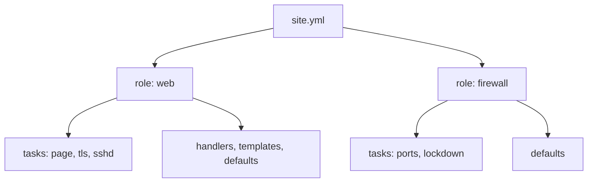

# Lab A11: Roles and structure (stretch)

By now you have five separate playbooks, each with its own copy of the hosts line, the reload handler and `pc_net`. That works, but it does not scale: a team needs to find things, reuse them and change one thing in one place. **Roles** are Ansible's answer. In this lab you reorganise the same work into two roles, `web` and `firewall`, without changing what happens on the network.

**Stretch lab, part 2.** Skip it if time is short. About 20 min. You need Labs A4 to A8 finished, since you are moving their tasks.

Your pod number is the number in your login name (`student07` is pod 07). The page fills it in where you see it below; if you still see `@POD@`, use that number. The same starter is in `~/netlab/labs/7-roles/`.

---

## In this lab

| Concept or command | What it does |
| ------------------ | ------------ |
| `roles/<name>/` | A folder layout Ansible knows: `tasks/`, `handlers/`, `templates/`, `defaults/` |
| `defaults/main.yml` | A role's default variables, the lowest precedence |
| `import_tasks` / `include_tasks` | Pull a task file into a role (at load time / at run time) |
| `tags:` and `--tags` | Run only part of a playbook |
| `--list-tags` | Show the tags a playbook defines |
| `ansible-lint` | Check a playbook for common mistakes and style problems |

---

## The idea: a refactor must not change behaviour



A refactor changes the **shape** of the code, not the result. That gives you a clear test of whether you did it right: rebuild the pod from clean, and the result must be exactly what Lab A9 produced, with `changed=0` on a second run. If anything differs, the refactor changed behaviour and is wrong.

The layout answers "where is the thing?":

| Folder | What goes here | Came from |
| ------ | -------------- | --------- |
| `roles/web/tasks/page.yml` | the nginx page | Lab A4 |
| `roles/web/tasks/tls.yml` | certificate and server block | Lab A6 |
| `roles/web/tasks/sshd.yml` | sshd hardening | Lab A7 |
| `roles/web/templates/` | `index.html.j2`, `tls.conf.j2`, `sshd_config.j2` | Labs A4, A6, A7 |
| `roles/web/handlers/main.yml` | reload nginx and sshd | Labs A6, A7 |
| `roles/firewall/tasks/ports.yml` | the allow rules | Lab A5 |
| `roles/firewall/tasks/lockdown.yml` | the lockdown with tests and rollback | Lab A8 |

---

## 1. Plan before you move

Nothing to type yet. Open your five playbooks and list **what repeats** (the `hosts:` line, the reload handler, `pc_net`) and **which tasks belong to the web server and which to the firewall**. That list *is* the role layout, and it is the step people skip. Moving code without it gives you folders and no structure.

---

## 2. The layout

```sh
cd ~/netlab/labs/7-roles
find roles -type f | sort
```

The starter has every file, each holding only a `TODO` comment. `site.yml` has one play per role, with the web servers first (the lockdown's tests need them running). Each play still says `roles: []`; replace that with the role, so the file reads:

```yaml
- name: Web servers
  hosts: web:&auto
  gather_facts: false
  roles:
    - role: web

- name: Firewall
  hosts: fw:&auto
  serial: 1
  gather_facts: false
  roles:
    - role: firewall
```

---

## 3. Move the tasks

Copy each lab's **tasks** (not the `hosts:` or `vars:` header) into the matching file. A task file is just a list:

```yaml
---
- name: Web page
  ansible.builtin.template:
    src: index.html.j2
    dest: /var/www/html/index.html
```

Things to change while moving:

- Templates go in `roles/web/templates/`; the role finds them by name, so `src: tls.conf.j2` needs no path.
- Handlers go in `roles/web/handlers/main.yml` as a plain list. `notify:` names still match.
- Variables like `tls_dir` and the sshd numbers go in `roles/web/defaults/main.yml`:

```yaml
page_title: Netlab student
tls_dir: /etc/nginx/tls
sshd_max_auth_tries: 3
sshd_login_grace_time: 20
sshd_x11_forwarding: "no"
```

- `roles/web/tasks/main.yml` chooses the parts and tags them:

```yaml
---
- name: Web page
  ansible.builtin.import_tasks: page.yml
  tags: [web, page]

- name: HTTPS
  ansible.builtin.import_tasks: tls.yml
  tags: [web, tls]

- name: SSH hardening
  ansible.builtin.import_tasks: sshd.yml
  tags: [web, sshd]
```

The firewall role's `main.yml` does the same for `ports.yml` and `lockdown.yml`, with tags `ports` and `lockdown`.

**Why `defaults/`?** They are the lowest-precedence variables. `group_vars/web.yml` (Lab A7) still wins over them, so the role has sensible values out of the box and each team can override them without editing the role. That is what makes it reusable.

**`import_tasks` or `include_tasks`?** `import_` is decided when the playbook loads, so `--list-tags` and tags see everything. `include_` is decided at run time, which allows loops and conditions over files but hides the tasks from tags. Use `import_` unless you need that flexibility.

---

## 4. Run it

```sh
cd ~/netlab
ansible-playbook reset_fw.yml -e branch=a
ansible-playbook labs/7-roles/site.yml
ansible-playbook labs/7-roles/site.yml
```

The first run builds the full state (`changed`), the second is `changed=0`. That is the same result as the capstone from Lab A9, from a different structure.

Now use the tags:

```sh
ansible-playbook labs/7-roles/site.yml --list-tags
ansible-playbook labs/7-roles/site.yml --tags tls
```

`--tags tls` runs only the certificate and server block: a fast, targeted run that was impossible when each lab was a separate file. Then check the code itself:

```sh
ansible-lint labs/7-roles/site.yml
```

`ansible-lint` works offline and reads `.ansible-lint` in your workspace; fix anything it reports.

---

## 5. Prove nothing changed

```sh
ansible-playbook probe.yml -e branch=a -e expect=allowed
ansible-playbook probe.yml -e branch=a -e port=8080 -e expect=blocked
ansible-playbook compare.yml
```

`compare.yml` should print `same` for both: the roles build exactly what your hands did on branch m.

---

## The twist: change one place

Set a different value in the role's defaults, then override it for one host:

```sh
sed -i 's/^sshd_max_auth_tries:.*/sshd_max_auth_tries: 4/' labs/7-roles/roles/web/defaults/main.yml
mkdir -p host_vars
printf 'sshd_max_auth_tries: 5\n' > host_vars/web-a-@POD@.yml
ansible-playbook labs/7-roles/site.yml
ansible 'web:&auto' -m ansible.builtin.command -a "sshd -T"
```

**Your turn:** which number does `sshd -T` show, 3, 4 or 5, and why?

<!-- dojo-reveal: Which wins? -->

Whichever has the **highest precedence** that applies to this host. The role default (4) is the lowest, `group_vars/web.yml` (3 from Lab A7) beats it, and `host_vars/web-a-@POD@.yml` (5) beats the group. So `sshd -T` shows `maxauthtries 5` for this host only. You changed behaviour for one machine without touching the role, which is the reason roles exist. Delete `host_vars/web-a-@POD@.yml` and put the default back to 3 when you are done, then rerun twice: the first run puts the value back (`changed`), the second returns to `changed=0`.

<!-- /dojo-reveal -->

---

## Check your work

```sh
cd ~/netlab
dojo netlab check A11
```

It checks that the roles build the same final state as the earlier labs. Each line says `PASS` or `FAIL` with the reason. The checker allows about six runs a minute.

---

## If you are stuck

| You see | Cause and fix |
| ------- | ------------- |
| `the role 'web' was not found` | Run from `~/netlab` and keep the `roles/` folder next to `labs/7-roles/site.yml` |
| `Could not find or access 'tls.conf.j2'` | The template is not in `roles/web/templates/` |
| The handler never runs | The `notify:` name must match the handler's `name:` exactly |
| The second run is not `changed=0` | A moved task lost its `creates:`, `changed_when:` or `validate:` |
| `--tags tls` runs everything | `tags:` is missing on that `import_tasks` line |
| `ansible all -m ping` shows `UNREACHABLE` | The pod is still starting. Wait a minute, then `ansible-playbook reset_fw.yml -e branch=a` |

---

## Recap

- A **role** is a folder layout for one job; `site.yml` just says which hosts get which roles.
- A refactor is correct only if the **result is unchanged**: same state, `changed=0`, `compare.yml` clean.
- `defaults/` are the lowest-precedence variables, so every team can override them without editing the role.
- `import_tasks` plus `tags:` lets you run one part of a playbook.
- `ansible-lint` catches mistakes before they run.

**Back to:** the [lab index](lab-index.md).
