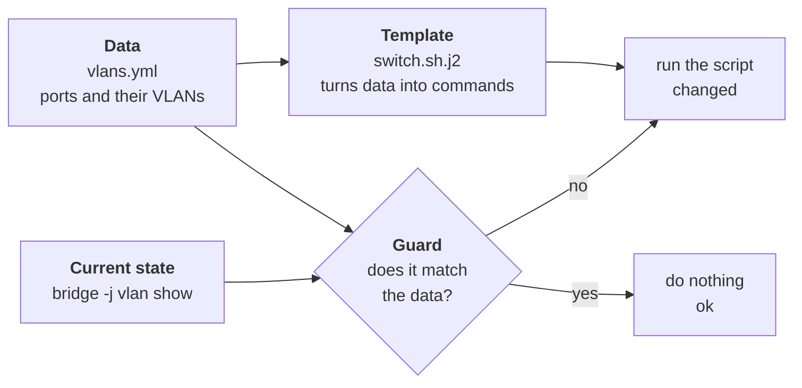

# Lab A2: VLANs and access ports, as code

In [Lab M2](labM2.md) you built the switch's access ports with four typed commands. Now you describe the **result you want** and let a playbook make it so. There is no Ansible module for this switch, so this lab is a small design exercise: you choose how to store the data, how to turn it into commands, and how to make the playbook safe to run again. Those three ideas, **data, template, guard**, come up in almost every real automation.

**Part 2: as a playbook, on branch a.** About 20 min. This is the same job you did by hand in [Lab M2](labM2.md).

Your pod number is the number in your login name (`student07` is pod 07). The page fills it in where you see it below; if you still see `@POD@`, use that number.

---

## In this lab

| Concept or command | What it does |
| ------------------ | ------------ |
| `vars_files:` | Load variables from a file next to the playbook |
| `ansible.builtin.command` + `register` | Run a command and keep its output in a variable |
| `from_json` | Turn JSON text (from `bridge -j vlan show`) into data Ansible can compare |
| `ansible.builtin.template` | Fill in a Jinja2 text file from variables |
| `when:` | Run a task only if a condition is true |
| `changed_when:` | Tell Ansible when a command really changed something |
| `ansible-playbook <file>` | Run a playbook |

---

## The idea: describe the state, not the steps

By hand you typed *commands*. A playbook holds the *state you want*, and a few tasks that reach it only if it is not already there:



- **Data.** The ports and VLANs live in one variable, not inside the commands. To add a port later you add a line of data.
- **Template.** A small file with placeholders that Ansible fills from the data to produce the script that sets the VLANs.
- **Guard.** Before changing anything, read the switch's current table and compare it with the wanted data. If they match, do nothing: this is what makes a second run report `changed=0`.

---

## 1. Break branch a's switch

Branch m was blanked in M2. Do the same to branch a so there is something to build:

```sh
cd ~/netlab
ansible-playbook reset_switch.yml -e branch=a
ansible-playbook probe.yml -e branch=a -e proto=icmp -e expect=blocked
```

The probe should say `PASS`: every port is in VLAN 1 and the pc cannot reach the web server. This is the state your playbook has to fix.

Open `labs/S1-vlans/site.yml` in the editor. It is a blank file on purpose.

---

## 2. Write the data model

Create `labs/S1-vlans/vlans.yml` next to `site.yml`:

```yaml
vlans:
  - {id: 10, name: pc,  gateway: 10.10.10.1/24}
  - {id: 20, name: web, gateway: 10.10.20.1/24}

switch_ports:
  - {name: to-pc,  vids: [10], pvid: 10}
  - {name: to-web, vids: [20], pvid: 20}
```

`vlans` lists the VLANs in the pod. `switch_ports` has one entry per port: its `name`, the VLAN ids it carries (`vids`) and its untagged VLAN (`pvid`, with `0` meaning none). This is the whole of Lab M2 in six lines, and it is the only place you will ever edit when a VLAN changes.

**Your turn:** `to-fw` is not in the list. Why leave it out for now?

<!-- dojo-reveal: Why no to-fw? -->

Because this lab is only about the access ports. The trunk is Lab A3, which just adds one line to this list. Keeping each lab to one idea is also why the pod is reset between them.

<!-- /dojo-reveal -->

---

## 3. Write the template

Create `labs/S1-vlans/switch.sh.j2`. A `.j2` file is **Jinja2**: ordinary text with `{{ }}` for values and `` for loops and conditions.

```jinja
#!/bin/sh
# Managed by Ansible. Sets each switch port to exactly the VLANs in vlans.yml.



bridge vlan del dev {{ p.name }} vid {{ v }} 2>/dev/null || true


bridge vlan add dev {{ p.name }} vid {{ v }}{{ ' pvid untagged' if p.pvid == v else '' }}


```

How to read it:

- For every port, it first **deletes** VLAN 1 and each managed VLAN (`|| true` so a "not there" error is ignored), starting every port from a known clean state.
- Then it **adds** the VLANs the data says, tagging `pvid untagged` only for the port's own untagged VLAN.
- Rendered for your data it produces exactly the four `bridge vlan` commands you typed in M2, plus the clean-up.

Delete-then-add is a deliberate design choice: it makes the result depend only on the data, no matter what the port looked like before.

---

## 4. Write the playbook

Now `site.yml`. Build it in three tasks. Write this skeleton and fill in what the comments ask:

```yaml
- name: VLANs and access ports on the switch
  hosts: sw:&auto
  gather_facts: false
  vars_files: [vlans.yml]
  tasks:
    - name: Read the VLAN table
      ansible.builtin.command: bridge -j vlan show
      register: bvlan
      changed_when: false

    - name: Is it already right?
      ansible.builtin.set_fact:
        in_sync: "{{ false }}"      # TODO: compare what the switch has with switch_ports

    - name: Write the script that sets the VLANs
      ansible.builtin.template:
        src: switch.sh.j2
        dest: /root/switch-vlans.sh
        mode: "0700"

    - name: Apply it (only when the table differs)
      ansible.builtin.command: sh /root/switch-vlans.sh
      when: not in_sync
      changed_when: true
```

Taking it apart:

- `hosts: sw:&auto` targets only branch a's switch.
- Task 1 reads the table. `changed_when: false` tells Ansible this only *looks*, so it should never report a change.
- Task 2 is the **guard**: a true/false `in_sync`. This is the part you design.
- Task 3 writes the script to the switch; the `template` module only reports `changed` if the text differs from what is already there.
- Task 4 runs the script, but only `when: not in_sync`. `changed_when: true` is honest here: if it ran, it changed things.

**The guard.** `bridge -j vlan show` prints JSON, a list of ports each with a `vlans` list of `{vlan, flags}`:

```text
[{"ifname":"to-pc","vlans":[{"vlan":10,"flags":["PVID","Egress Untagged"]}]}, ...]
```

Parse it with `bvlan.stdout | from_json`, turn it into the same shape as `switch_ports` (a list of `{name, vids, pvid}`) and compare with `==`. The comparison is the tricky bit: think about how to find the PVID, and about sorting both lists so order never causes a false "different".

<!-- dojo-reveal: Hint: one way to build the current state -->

Add these `vars:` to the play (next to `vars_files`). They build the "have" list from the JSON, in the same shape as `switch_ports`:

```yaml
  vars:
    names: "{{ switch_ports | map(attribute='name') | list }}"
    want: "{{ switch_ports | sort(attribute='name') }}"
    have: >-
      
      
        
        
          
        
        
      
      {{ out | to_json }}
```

and then make the `set_fact` task say `in_sync: "{{ (have | from_json) == want }}"`. The loop collects each port's VLAN ids, and the last PVID it finds, or 0 if there is none. It only looks at the ports you manage (`names`).

<!-- /dojo-reveal -->

---

## 5. Run it, twice

```sh
ansible-playbook labs/S1-vlans/site.yml
ansible-playbook labs/S1-vlans/site.yml
```

Read the two `PLAY RECAP` lines. The first run should report `changed` for the template and the apply task; the second must say `changed=0`. **That second run is the proof** that your guard works: Ansible looked, saw the switch already matched the data, and left it alone.

**Your turn:** predict what the second run does to the apply task: does it say `ok`, `changed` or `skipping`?

<!-- dojo-reveal: The second run -->

`skipping`. The `when: not in_sync` is false, so Ansible does not even run the script. The template task reports `ok` because the file's text is unchanged.

<!-- /dojo-reveal -->

Look at the result:

```sh
ansible "sw:&auto" -m ansible.builtin.command -a "bridge vlan show"
ansible-playbook probe.yml -e branch=a -e proto=icmp -e expect=blocked
```

`to-pc` should be `10 PVID Egress Untagged` and `to-web` `20 PVID Egress Untagged`, with no VLAN 1 on either. The probe still says blocked: the trunk is Lab A3.

---

## Prove both branches match

Compare branch a with the branch you built by hand:

```sh
ansible "sw" -m ansible.builtin.command -a "bridge vlan show"
```

Both switches (`sw-m-@POD@` and `sw-a-@POD@`) should show the same table for `to-pc` and `to-web`. One was built by four typed commands, the other from six lines of data, and they end in the same place.

---

## The twist

Change one value in `vlans.yml`, for example make `to-web` use VLAN **30**, and rerun. Only the affected commands change. Change it back and rerun to restore it. Then add a fourth port to the list: by hand that is another round of `bridge` commands on a switch you have to log in to, here it is one more line of data.

---

## Check your work

```sh
cd ~/netlab
dojo netlab check A2
```

The checker reads the VLAN table on both switches and confirms `to-pc` and `to-web` are untagged access ports in the right VLANs. Fix what failed and run it again (about six runs a minute).

---

## If you are stuck

| You see | Cause and fix |
| ------- | ------------- |
| `dojo netlab check A2` fails on branch M | Finish [Lab M2](labM2.md) by hand first: the checker looks at both branches |
| `The error was: ... 'switch_ports' is undefined` | `vars_files: [vlans.yml]` is missing, or `vlans.yml` is not next to `site.yml` |
| The second run still says `changed` | Your guard is comparing differently-shaped or differently-ordered lists. Print both with `ansible.builtin.debug` and look |
| You broke the switch | `ansible-playbook reset_switch.yml -e branch=a -e restore=true` restores the working baseline |
| `ansible all -m ping` shows `UNREACHABLE` | The pod is starting: wait a minute and run `ansible-playbook verify_topology.yml` |

---

## Recap

- A playbook holds **state**, not steps: here a list of ports and VLANs.
- **Data, template, guard**: keep the facts in a variable, generate the commands from them, and only run when the real state differs.
- `changed_when: false` marks a read-only command; `register` keeps its output; `from_json` makes JSON usable.
- Idempotency is something you build in when no module does it for you. `changed=0` on the second run proves it.

**Next:** [Lab A3](labA3.md): the trunk, driven by the same data.
