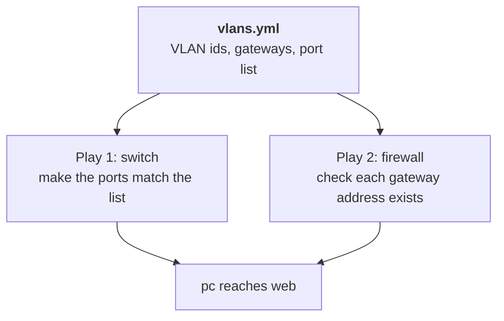

# Lab A3: Trunk and router-on-a-stick, as code

In [Lab M3](labM3.md) you made the switch's `to-fw` port a trunk by hand and the pc could reach the web server again. Now do the same in the playbook you started in Lab A2, and make a bigger point: **one list of VLANs can drive two different devices**, the switch *and* the firewall, so they can never disagree.

**Part 2: as a playbook, on branch a.** About 20 min. This is the same job you did by hand in [Lab M3](labM3.md).

Your pod number is the number in your login name (`student07` is pod 07). The page fills it in where you see it below; if you still see `@POD@`, use that number.

> **Starting here?** You need the access ports from [Lab A2](labA2.md) on branch a. Check with `ansible "sw:&auto" -m ansible.builtin.command -a "bridge vlan show"`.

---

## In this lab

| Concept or command | What it does |
| ------------------ | ------------ |
| Two plays in one file | Run different tasks on different hosts, in order |
| `ansible.builtin.assert` | Fail loudly, with a message, unless a condition is true |
| `loop:` | Repeat a task for each item in a list |
| `serial: 1` | Run a play on one host at a time, stopping at the first failure |
| `ip -o -4 addr show` | List a node's IPv4 addresses, one per line |

---

## The idea: one source of truth, two devices

The switch and the firewall have to agree about VLANs: if the switch carries VLAN 30 but the firewall has no interface for it, traffic goes nowhere. By hand, you must remember to do both. In a playbook, keep the VLAN facts in **one variable** and let both plays read it:



Play 1 changes the switch. Play 2 does not change the firewall (its VLAN interfaces already exist), it **asserts** that they do: a check that stops the run with a clear message if the firewall is not set up as the data says.

---

## 1. Copy and extend the data

Work in `labs/S2-trunk/`. Start from your A2 files:

```sh
cd ~/netlab
cp labs/S1-vlans/vlans.yml labs/S1-vlans/switch.sh.j2 labs/S1-vlans/site.yml labs/S2-trunk/
```

Open `labs/S2-trunk/vlans.yml` and add one line to `switch_ports`:

```yaml
  - {name: to-fw, vids: [10, 20], pvid: 0}
```

A trunk is just a port that carries several VLANs with **no untagged VLAN**: `pvid: 0`. Your template already handles it: it adds `pvid untagged` only when a VLAN equals the port's `pvid`, and nothing equals 0. Your guard works for it too. **You did not change a line of the switch logic**, because the logic was written from data. That is the payoff of Lab A2's design.

---

## 2. Add the firewall check

Add a second play to the end of `site.yml`. It reads the firewall's addresses and asserts that each VLAN's gateway is present:

```yaml
- name: The firewall has a gateway address in each VLAN
  hosts: fw:&auto
  gather_facts: false
  vars_files: [vlans.yml]
  tasks:
    - name: Read the firewall's addresses
      ansible.builtin.command: ip -o -4 addr show
      register: addrs
      changed_when: false

    - name: Each VLAN's gateway is configured
      ansible.builtin.assert:
        that: item.gateway in addrs.stdout
        fail_msg: "No address {{ item.gateway }} on the firewall for VLAN {{ item.id }}"
        quiet: true
      loop: "{{ vlans }}"
      loop_control:
        label: "VLAN {{ item.id }}"
```

- `ip -o -4 addr show` prints one line per address, so `10.10.10.1/24` appears as text in `addrs.stdout`.
- The `assert` runs once per entry of `vlans` (`loop`). `item.gateway` is `10.10.10.1/24` for VLAN 10 and so on, matched by simple text search.
- **Match addresses, not interface names.** The VLAN interfaces are called `eth1.10` on one runtime and something else on another; the *address* is what matters and is the same everywhere.

If a VLAN's interface were missing, the command to create it would be `ip link add link <parent> name <parent>.<vid> type vlan id <vid>`, but here you only verify.

**Your turn:** both plays use `vars_files: [vlans.yml]`. What would break if you copied the VLAN list into each play instead?

<!-- dojo-reveal: Why a shared file -->

You would have two copies to keep in step. Edit one and forget the other, and the switch and firewall disagree: exactly the mistake a single source of truth prevents.

<!-- /dojo-reveal -->

---

## 3. Protect against a bad rollout

Add `serial: 1` to the **switch play** (right under `hosts:`):

```yaml
- name: VLANs and ports on the switch
  hosts: sw:&auto
  serial: 1
  gather_facts: false
```

`serial: 1` finishes the whole play on one host before starting the next, and **stops at the first failure**. With one switch it changes nothing visible, but on a real estate of fifty switches it means a mistake breaks one device, not all fifty. It is the habit worth forming now.

---

## 4. Run it, twice

```sh
ansible-playbook labs/S2-trunk/site.yml
ansible-playbook labs/S2-trunk/site.yml
ansible "sw:&auto" -m ansible.builtin.command -a "bridge vlan show"
ansible-playbook probe.yml -e branch=a -e proto=icmp -e expect=allowed
```

- The first run changes the switch (`changed`) and passes both asserts.
- The second run must say `changed=0`.
- `bridge vlan show` should list `to-fw` with plain `10` and `20` lines (tagged, no PVID).
- The probe should now say `PASS` for **allowed**: the pc reaches the web server through your trunk, exactly as it did on branch m.

---

## Prove both branches match

```sh
ansible sw -m ansible.builtin.command -a "bridge -j vlan show"
```

The tables of `sw-m-@POD@` and `sw-a-@POD@` should be identical: the same ports, the same VLANs, the same flags.

---

## The twist

Add a **third VLAN** to `vlans.yml`: a new entry in `vlans` (say id 30, gateway `10.10.30.1/24`) and add 30 to `to-fw`'s `vids`. Run the playbook. The switch changes to carry VLAN 30, and the **firewall assert fails**, because the firewall has no address in that network. You just watched the single source of truth catch a half-finished change *before* it caused an outage. Remove the third VLAN again and rerun to return to a green run.

---

## Check your work

```sh
cd ~/netlab
dojo netlab check A3
```

The checker reads `to-fw` on the switch (VLANs 10 and 20, tagged) and pings the web server from the pc. Run it again after fixing anything that failed (about six runs a minute).

---

## If you are stuck

| You see | Cause and fix |
| ------- | ------------- |
| The assert fails: `No address 10.10.10.1/24` | The firewall's VLAN interfaces are missing: run `ansible-playbook verify_topology.yml`, or look at `ip -o -4 addr show` on `fw-a-@POD@` |
| Ping still blocked after the run | `bridge vlan show` on the switch: `to-fw` must list 10 and 20 and not VLAN 1. Run the playbook again |
| The second run says `changed` | Same cause as Lab A2: the guard compares unlike shapes. Check `to-fw` has `pvid: 0` |
| You broke the switch | `ansible-playbook reset_switch.yml -e branch=a -e restore=true` restores the working baseline |

---

## Recap

- One variable can drive several devices; keep facts in one place so they cannot drift apart.
- A trunk is a port with several VLANs and `pvid: 0`. A good data model needed **no new logic**.
- `assert` turns "I assume this is configured" into a check that stops the run if it is not.
- `serial: 1` limits the blast radius of a bad change.

**Next:** [Lab A4](labA4.md): leave the switch and write your first web-server playbook.
