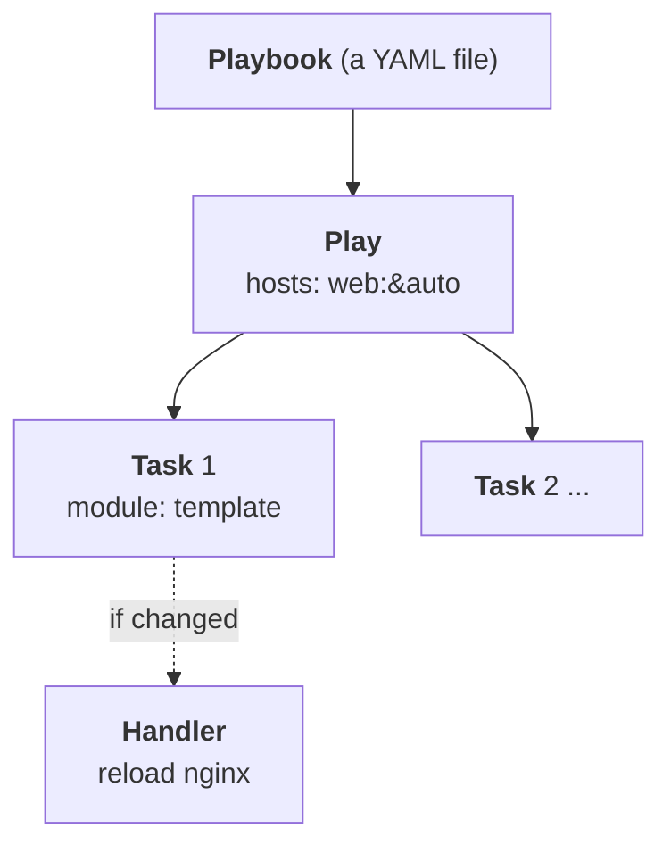

# Lab A4: A first playbook: the web page

This is where you stop typing commands and start writing **playbooks**: files that say what the system should look like and that Ansible checks and repairs. In [Lab M4](labM4.md) you wrote a page by hand with `echo`. Here you do the same job as a playbook, and in doing so meet the four ideas every playbook is built from: **plays, tasks, modules and handlers**.

**Part 2: as a playbook, on branch a.** About 15 min. This is the same job you did by hand in [Lab M4](labM4.md).

Your pod number is the number in your login name (`student07` is pod 07). The page fills it in where you see it below; if you still see `@POD@`, use that number.

> **Starting here?** The pod needs to be at its working baseline, with the switch trunk from [Lab A3](labA3.md) in place on branch a.

---

## In this lab

| Concept or command | What it does |
| ------------------ | ------------ |
| `ansible-playbook <file>` | Run a playbook |
| `hosts:` | Which hosts a play runs on (a pattern, like `web:&auto`) |
| `tasks:` | The ordered list of things to do |
| `ansible.builtin.copy` | Put a file with fixed content in place |
| `ansible.builtin.template` | Put a file in place, filling in `{{ variables }}` |
| `notify:` and `handlers:` | Run a follow-up action **only if** something changed |
| `--check` | Show what would change without changing it |

---

## The idea: anatomy of a playbook



- A **playbook** is a YAML file holding one or more **plays**.
- A **play** says *which hosts* and then lists *tasks*.
- A **task** is one call to a **module** with its arguments. Tasks run in order, top to bottom, on every host the play targets.
- A **handler** is a task that runs only when another task **notifies** it, and only if that task reported `changed`. It is how you say "reload nginx, but only if the page actually changed".

YAML is fussy about **indentation**. Two spaces per level, never tabs, and a list item starts with `- `. When something won't parse, look at the indentation first.

---

## 1. Open the starter

```sh
cd ~/netlab
```

Open `labs/1-first-playbook/site.yml` in the editor. It has the skeleton and numbered `TODO` markers. You will fill them in one at a time, running the playbook after each.

```yaml
- name: Web page
  hosts: web:&auto
  gather_facts: false
  vars:
    page_title: TODO   # your name
  tasks:
    ...
  handlers:
    ...
```

- `hosts: web:&auto` means web servers **and** on branch a. Your branch m is deliberately not touched.
- `gather_facts: false` skips the automatic fact collection at the start of a play. You do not need facts here, and skipping saves a few seconds.
- `vars:` defines variables. Set `page_title` to your name.

There is **no `become:`** anywhere in these labs. The nodes log you in as `root` already, and `sudo` does not exist in these containers.

---

## 2. TODO 1: put a file there with `copy`

Replace the placeholder task with:

```yaml
    - name: Page
      ansible.builtin.copy:
        content: "<h1>Hello from a</h1>\n"
        dest: /var/www/html/index.html
        mode: "0644"
```

`ansible.builtin.copy` with `content:` writes exactly that text to `dest:`; `mode: "0644"` sets the file permissions (quoted, so YAML does not treat it as a number). Run it:

```sh
ansible-playbook labs/1-first-playbook/site.yml
```

You should see the task marked `changed` and a `PLAY RECAP` with `changed=1`. Run it **again**.

**Your turn:** what does the second run report for the task, and why? Predict first.

<!-- dojo-reveal: The second run -->

`ok`, and the recap shows `changed=0`. The `copy` module compared the file on the web server with the content you gave it, saw they were identical and did nothing. A module that checks first and only acts when needed is **idempotent**: running it once or ten times leaves the same result. Your `echo` in Lab M4 had no such check.

<!-- /dojo-reveal -->

---

## 3. TODO 2: a template, so the page uses a variable

A fixed string is not very reusable. Create `labs/1-first-playbook/index.html.j2` next to the playbook:

```jinja
<!doctype html>
<title>{{ page_title }}</title>
<h1>Hello from {{ inventory_hostname }}</h1>
<p>{{ page_title }}</p>
```

`{{ ... }}` marks a **Jinja2** placeholder. `page_title` is your variable and `inventory_hostname` is built in: the name of the host the task is currently running on, so each server's page names itself. Now swap the task over to the `template` module:

```yaml
    - name: Page
      ansible.builtin.template:
        src: index.html.j2
        dest: /var/www/html/index.html
        mode: "0644"
```

`template` renders the `.j2` file on your machine, then puts the result on the target, again only if it differs. Run the playbook and then look at the result on the server:

```sh
ansible-playbook labs/1-first-playbook/site.yml
ansible "web:&auto" -m ansible.builtin.command -a "curl -s http://127.0.0.1/"
```

The page now shows your name and the server's own name.

---

## 4. TODO 3 and 4: a handler to reload nginx

Today nginx picks up the new page on its own, but many changes (a new site, a certificate) need nginx to **reload** its configuration. You do not want to reload on every run: only when something changed. That is a handler's job.

Add `notify:` to the page task, and fill in the handler at the bottom of the play:

```yaml
    - name: Page
      ansible.builtin.template:
        src: index.html.j2
        dest: /var/www/html/index.html
        mode: "0644"
      notify: Reload nginx

  handlers:
    - name: Reload nginx
      ansible.builtin.command: nginx -s reload
```

The name after `notify:` must match the handler's `name:` exactly. Handlers run **once, at the end of the play**, and only if at least one task that notified them reported `changed`. Change the title to see it work:

```sh
ansible-playbook labs/1-first-playbook/site.yml          # the page changes, so the handler runs
ansible-playbook labs/1-first-playbook/site.yml          # nothing changed: no handler
```

First run: the page task is `changed` and you see `RUNNING HANDLER [Reload nginx]`. Second run: both `ok`, no handler line, and `changed=0`.

---

## 5. Prove it

```sh
ansible-playbook probe.yml -e branch=a -e expect=blocked
```

The probe still says blocked (`PASS`): the page is on the server, but the firewall has not been told to let it through (Lab A5). Branch m, which you finished in Part 1, has the firewall open already, so the two branches are not yet the same. `compare.yml` is for the end of Part 2, once branch a has caught up (Lab A9).

---

## The twist

Change `page_title` in **one place** and rerun:

```sh
ansible-playbook labs/1-first-playbook/site.yml
```

Only the template task reports `changed` and the handler reloads nginx once. Now try the preview:

```sh
ansible-playbook labs/1-first-playbook/site.yml --check --diff
```

`--check` runs in "dry run" mode, `--diff` shows the lines that would change, and nothing is touched. Doing the by-hand equivalent on two servers means two SSH sessions and no record of what you did or why.

---

## Check your work

```sh
cd ~/netlab
dojo netlab check A4
```

It confirms the web page is no longer the default page on both branches (the one you wrote by hand in M4 and the one your playbook wrote). Each line says `PASS` or `FAIL` with the reason.

---

## If you are stuck

| You see | Cause and fix |
| ------- | ------------- |
| `ERROR! ... mapping values are not allowed here` or `did not find expected key` | A YAML indentation or colon problem. Compare your indentation with the examples: two spaces per level, `- ` for lists |
| `Could not find or access 'index.html.j2'` | The template must be in the same folder as `site.yml` (`labs/1-first-playbook/`) |
| `The requested handler 'Reload nginx' was not found` | `notify:` and the handler `name:` do not match exactly |
| Still the default page | You ran it from a different folder or edited the wrong file. Run `ansible-playbook` from `~/netlab` |
| `dojo netlab check A4` fails on branch M | You did not finish [Lab M4](labM4.md) on branch m (the check covers both branches) |

---

## Recap

- A **playbook** has **plays**; a play picks **hosts** and runs **tasks**; a task calls a **module**.
- `copy` and `template` check before they change, so a rerun is `changed=0` (**idempotent**).
- A **handler** runs only when notified by a task that changed something, and only once per play.
- `--check --diff` previews a run before you make it.
- The same playbook, run again, cannot make a second mistake.

**Next:** [Lab A5](labA5.md): open the firewall for the page, driven by a list.
