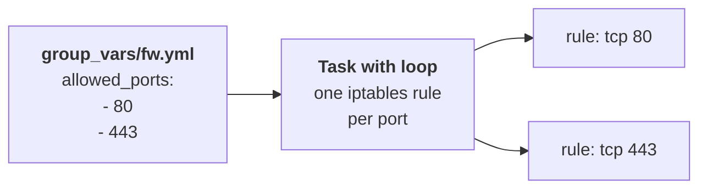

# Lab A5: Variables, loops and conditionals

In [Lab M5](labM5.md) you typed two nearly identical `iptables` commands, one for port 80 and one for 443. A third port would mean a third copy. This lab shows how to say it once: put the **list of ports in a variable** and let a **loop** make one rule per entry. You also learn where variables live and which one wins when two disagree, and you meet an important limit of what modules do.

**Part 2: as a playbook, on branch a.** About 15 min. This is the same job you did by hand in [Lab M5](labM5.md).

Your pod number is the number in your login name (`student07` is pod 07). The page fills it in where you see it below; if you still see `@POD@`, use that number.

---

## In this lab

| Concept or command | What it does |
| ------------------ | ------------ |
| `vars:` / `group_vars/` | Where you define variables: in the play, or in a file for a group of hosts |
| `loop:` and `{{ item }}` | Repeat one task for every entry of a list |
| `loop_control: label:` | Keep the output of a loop short and readable |
| `when:` | Run a task only if a condition holds |
| `ansible.builtin.iptables` | Manage firewall rules, checking before it adds |
| `-e` / `--extra-vars` | Override a variable on the command line |

---

## The idea: data in one place, logic in another



The task never mentions 80 or 443. It says "for each port in `allowed_ports`". To change what is open you edit the list, not the logic. That is why a variable is worth the extra line: the list is **data** (changes often), the task is **logic** (changes rarely).

---

## 1. Open the starter

```sh
cd ~/netlab
```

Open `labs/2-variables-loops/site.yml`. It sets the play up for you:

```yaml
- name: Open the web ports
  hosts: fw:&auto
  gather_facts: false
  vars:
    allowed_ports: []
    pc_net: 10.10.10.0/24
  tasks:
    ...
```

`pc_net` is the pc's network. `web_ip` (the web server's address, `10.10.20.10`) is already defined for every host in `group_vars/all.yml`, so you can use `{{ web_ip }}` without declaring it.

---

## 2. TODO 1 and 2: a list and a loop

Fill in the list, then replace the placeholder task:

```yaml
  vars:
    allowed_ports:
      - 80
      - 443
    pc_net: 10.10.10.0/24
  tasks:
    - name: Allow the pc network to reach the web server on each port
      ansible.builtin.iptables:
        chain: LAB
        protocol: tcp
        source: "{{ pc_net }}"
        destination: "{{ web_ip }}"
        destination_port: "{{ item | string }}"
        jump: ACCEPT
      loop: "{{ allowed_ports }}"
```

This is the Lab M5 command, argument by argument:

| iptables flag by hand | `iptables` module argument |
| --------------------- | -------------------------- |
| `-A LAB` | `chain: LAB` (the default action is "append") |
| `-p tcp` | `protocol: tcp` |
| `-s 10.10.10.0/24` | `source: "{{ pc_net }}"` |
| `-d 10.10.20.10` | `destination: "{{ web_ip }}"` |
| `--dport 80` | `destination_port: "{{ item \| string }}"` |
| `-j ACCEPT` | `jump: ACCEPT` |

`loop:` runs the task once per entry; inside it `{{ item }}` is the current entry. `| string` is a Jinja2 **filter** that turns the number 80 into the text `"80"`, because the module wants text. Run it:

```sh
ansible-playbook labs/2-variables-loops/site.yml
```

You see `changed` for each item and `changed=1` in the recap (one *task*, two items). Run it again.

**Your turn:** by hand, typing `iptables -A` twice added the rule twice. Predict what the second run of this playbook does.

<!-- dojo-reveal: The second run -->

It reports `ok` (`changed=0`) and adds nothing. The `iptables` module checks whether the rule already exists before adding it, which is what the shell command never does. This is the main reason to prefer a module over `command: iptables ...`.

<!-- /dojo-reveal -->

---

## 3. TODO 3 and 4: a condition, and tidier output

```yaml
      loop: "{{ allowed_ports }}"
      loop_control:
        label: "port {{ item }}"
      when: allowed_ports | length > 0
```

- `loop_control: label:` makes the output say `item=port 80` instead of dumping the whole item.
- `when:` runs the task only if the condition is true. Here an **empty** list is skipped cleanly instead of failing. `| length` is another filter.

---

## 4. Move the data out: `group_vars`

The list belongs with the firewall, not inside a particular playbook. Create `group_vars/fw.yml` in `~/netlab` (next to `group_vars/all.yml`):

```yaml
allowed_ports:
  - 80
  - 443
pc_net: 10.10.10.0/24
```

Then **delete** `allowed_ports` and `pc_net` from the play's `vars:` and run again. Ansible loads `group_vars/fw.yml` for every host in the `fw` group, so your task finds the same values. The recap is still `changed=0`: nothing differs on the firewall, only where the data lives.

**Your turn:** `-e` overrides everything. Run the playbook with a different list, and predict what it does to the existing rules before you look:

```sh
ansible-playbook labs/2-variables-loops/site.yml -e '{"allowed_ports": [80, 443, 8080]}'
```

(`-e` takes JSON when the value is a list. Writing `-e allowed_ports=[80]` would pass a *string* and fail with "The `loop` value must resolve to a 'list'".)

<!-- dojo-reveal: What happens? -->

One new rule: 80 and 443 are `ok`, and only `port 8080` is `changed`. **Variable precedence** is the rule that decides which source wins when a variable is defined twice: command-line `-e` beats `group_vars`, which beats a default. That makes `-e` handy for a one-off, and dangerous if you forget it is there.

<!-- /dojo-reveal -->

---

## 5. Prove it

```sh
ansible-playbook probe.yml -e branch=a -e expect=allowed
ansible-playbook probe.yml -e branch=a -e port=8080 -e expect=blocked
ansible "fw:&auto" -m ansible.builtin.command -a "iptables -S LAB"
```

- The first probe (port 80) should say `PASS`, because the page is now reachable from the pc.
- The 8080 probe says `blocked` only if you have **not** left the 8080 rule from step 4: if it says `FAIL`, that rule is still in the firewall, which leads straight into the twist.
- Port 443 cannot be probed yet because nothing listens on it (Lab A6 fixes that), so read the rules instead: the listing should show `--dport 80` and `--dport 443`.

---

## The twist

Remove 8080 from the list (or just run without `-e`) and rerun. **Is the 8080 rule gone?** Check with `iptables -S LAB` as above.

<!-- dojo-reveal: The answer -->

No. The module only **adds**: it makes sure the rules you list exist, but it never removes ones you stopped listing. The list is not "the whole truth", only "at least this". To make it the truth you must start from a clean chain: flush `LAB` first (the lockdown in Lab A8 does it), or run `ansible-playbook reset_fw.yml -e branch=a` and apply the playbook again.

This surprises people more than any other Ansible behaviour, and it is the best argument for the rebuild-from-clean test in Lab A9: a playbook that has only ever been applied on top of old state may hide leftovers.

<!-- /dojo-reveal -->

Clean up before you continue: `ansible-playbook reset_fw.yml -e branch=a`, then run the playbook once more (the reset also sends the web server back to its default page, so you rewrite it with Lab A4's playbook afterwards).

---

## Check your work

```sh
cd ~/netlab
dojo netlab check A5
```

It checks that port 80 answers, that ports 22 and 8080 are blocked, and that a rule for 443 exists. Each line says `PASS` or `FAIL` with the reason.

---

## If you are stuck

| You see | Cause and fix |
| ------- | ------------- |
| `The loop value must resolve to a 'list', not 'str'` | A list passed with `-e name=[...]` is a string: use `-e '{"name": [..]}'` |
| `'allowed_ports' is undefined` | The list is in neither the play nor `group_vars/fw.yml` (check the file name and indentation) |
| The 8080 probe says `FAIL` | An 8080 rule is left over: `ansible-playbook reset_fw.yml -e branch=a`, then apply the playbook again |
| Everything on branch a is blocked after a mistake | `ansible-playbook reset_fw.yml -e branch=a` returns the firewall and web node to the baseline |
| `dojo netlab check A5` fails on M | Your by-hand firewall on branch m is not in the right state: see the checks in [Lab M5](labM5.md) |

---

## Recap

- Put changing **data** in variables (`group_vars/`) and keep the **task** generic.
- `loop:` and `{{ item }}` repeat a task; `when:` skips it; `loop_control: label:` keeps output readable.
- `ansible.builtin.iptables` checks before it adds, so reruns are `changed=0`.
- Precedence: `-e` on the command line beats `group_vars`, which beats a default.
- Modules **add**; they do not clean up what you stop listing.

**Next:** [Lab A6](labA6.md): HTTPS, and making a command safe to run twice.
