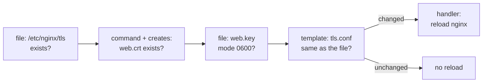

# Lab A6: Idempotency and check mode

In [Lab M6](labM6.md) you made a certificate, wrote a server block and reloaded nginx by hand. Doing that twice would have made a *second* certificate and replaced the first. In this lab you write the same job as a playbook and learn the property that makes playbooks safe: **idempotency**, meaning that running it again changes nothing. You also learn **check mode**, a dry run that shows what *would* change.

**Part 2: as a playbook, on branch a.** About 15 min. This is the same job you did by hand in [Lab M6](labM6.md).

Your pod number is the number in your login name (`student07` is pod 07). The page fills it in where you see it below; if you still see `@POD@`, use that number.

> **Starting here?** You need ports 80 and 443 open on branch a from [Lab A5](labA5.md), and the web server up from [Lab A4](labA4.md).

---

## In this lab

| Concept or command | What it does |
| ------------------ | ------------ |
| `ansible.builtin.file` | Make sure a directory exists, or set a file's mode |
| `ansible.builtin.command` + `creates:` | Run a command only if a file is missing |
| `ansible.builtin.template` + `notify:` | Write a file from a template and trigger a handler only if it changed |
| `changed_when:` | Tell Ansible when a command counts as a change |
| `--check --diff` | Show what would change, without changing it |

---

## The idea: describe the end state

A shell script says *do these steps*. A playbook says *this should be true when you finish*. Each module compares the machine with what you described and acts only on the difference. When nothing differs, it reports `ok`, not `changed`. That is **idempotency**: apply it once or ten times, and the machine ends up the same.



The risk is `command`. Ansible cannot see inside a shell command, so it assumes every `command` changed something. Two options fix that: `creates:` (skip if this file exists) and `changed_when:` (you say what counts as a change).

---

## 1. Open the starter

```sh
cd ~/netlab
```

Open `labs/3-idempotency/site.yml`. It is a play on `web:&auto` with five TODOs and a handler `Reload nginx` already written.

---

## 2. TODO 1 to 3: the directory, the certificate and the key

```yaml
    - name: TLS directory exists
      ansible.builtin.file:
        path: "{{ tls_dir }}"
        state: directory

    - name: Create the certificate and key (once)
      ansible.builtin.command:
        argv:
          - openssl
          - req
          - -x509
          - -newkey
          - rsa:2048
          - -nodes
          - -days
          - "365"
          - -subj
          - /CN=web
          - -keyout
          - "{{ tls_dir }}/web.key"
          - -out
          - "{{ tls_dir }}/web.crt"
        creates: "{{ tls_dir }}/web.crt"

    - name: Key is private
      ansible.builtin.file:
        path: "{{ tls_dir }}/web.key"
        mode: "0600"
      when: not ansible_check_mode
```

- `argv:` takes the command as a **list**, one word per line, so you never have to worry about quoting. It is the same `openssl` command as Lab M6.
- `creates:` is the idempotency guard. Ansible checks for `web.crt` first and **skips** the task if it exists, which is why the certificate is made once and never replaced.
- `when: not ansible_check_mode` skips the key-mode task in a preview (the twist below). In check mode the `openssl` task is skipped, so on a clean node the key file does not exist yet and `file` would fail with "file is absent". The real run is unaffected.
- `state: directory` and `mode:` describe the end state. If the directory exists, or the mode is already `0600`, nothing happens.

---

## 3. TODO 4: the server block and the reload

Create `labs/3-idempotency/tls.conf.j2` next to `site.yml`:

```nginx
server {
    listen 443 ssl;
    ssl_certificate     {{ tls_dir }}/web.crt;
    ssl_certificate_key {{ tls_dir }}/web.key;
    root /var/www/html;
}
```

Then the task that installs it:

```yaml
    - name: HTTPS server block
      ansible.builtin.template:
        src: tls.conf.j2
        dest: /etc/nginx/http.d/tls.conf
      notify: Reload nginx
```

`template` fills in `{{ tls_dir }}` and writes the file **only if the result differs** from what is there. `notify:` queues the handler, and handlers run **once, at the end of the play, and only if something notified them**. So nginx is reloaded when the config changed and left alone when it did not.

---

## 4. TODO 5: test before you reload

```yaml
    - name: Config is valid
      ansible.builtin.command: nginx -t
      changed_when: false
```

`nginx -t` does not change anything; it only checks the config. `changed_when: false` tells Ansible to report `ok` instead of the default `changed`. Without it, every run of the playbook would show a change and you could never tell a real one from noise.

Remove the placeholder `TODO` task, then run:

```sh
ansible-playbook labs/3-idempotency/site.yml
ansible-playbook labs/3-idempotency/site.yml
```

- The first run shows `changed` for the directory, certificate, key mode and server block, and the handler runs.
- The second run must show `changed=0`. If it does not, one of your tasks is not idempotent: read its line to find which.

**Your turn:** `nginx -t` runs *before* the handlers. If you made a typo in `tls.conf.j2`, what is the benefit of that order?

<!-- dojo-reveal: The order -->

The playbook stops at `nginx -t` with the error, so nginx is never asked to reload a broken config. Handlers run only at the end, after all the tasks succeed. Compare Lab M6, where you had to remember to run `nginx -t` yourself before `nginx -s reload`; here the order is part of the playbook.

<!-- /dojo-reveal -->

---

## 5. Prove it

```sh
ansible-playbook probe.yml -e branch=a -e port=443 -e expect=allowed
ansible-playbook probe.yml -e branch=a -e port=22 -e expect=blocked
```

Port 443 should now say `PASS`: the firewall allows it (Lab A5) and nginx answers (this lab).

---

## The twist: check mode

Check mode shows what **would** change without touching anything. Add `server_tokens off;` inside the `server` block of `tls.conf.j2`, then run:

```sh
ansible-playbook labs/3-idempotency/site.yml --check --diff
```

You get a diff of the server block and no change on the machine. Look at the other tasks: the `nginx -t` command is **skipped** in check mode, because Ansible cannot know that a bare command is read-only. The certificate task is also not touched, because `creates:` says the file already exists.

**Your turn:** is the certificate task safe to run twice because of `creates:`, or because of something else?

<!-- dojo-reveal: The answer -->

Only because of `creates:`. `openssl` has no idea that a certificate already exists and would happily make a new one that does not match the key nginx uses. `creates:` is your promise to Ansible that the file's existence means the job is done. If you delete `web.crt` but leave `web.key`, the task runs again and replaces both; if you only ever delete `web.key`, it will not run. Idempotency for a `command` is only as good as the guard you give it.

<!-- /dojo-reveal -->

Now run it for real, and re-run to confirm `changed=0`. Compare this with Lab M6, where you would be editing a live file by hand with no preview.

---

## Check your work

```sh
cd ~/netlab
dojo netlab check A6
```

It checks that HTTPS answers on branch a, that the key is mode 0600, and that the other ports are still blocked. Each line says `PASS` or `FAIL` with the reason. The checker allows about six runs a minute.

---

## If you are stuck

| You see | Cause and fix |
| ------- | ------------- |
| The second run is not `changed=0` | A `command` task has no `creates:` or `changed_when:`: add one |
| `nginx -t` fails with `cannot load certificate` | The key or certificate is missing: delete `/etc/nginx/tls` on the web node and run again |
| The 443 probe says `FAIL` | Port 443 is not open (Lab A5), or nginx is not listening: `ansible web:\&auto -m command -a "ss -ltn"` |
| `ansible all -m ping` shows `UNREACHABLE` | The pod is still starting. Wait a minute, then `ansible-playbook reset_fw.yml -e branch=a` |
| Everything on branch a is blocked after a mistake | `ansible-playbook reset_fw.yml -e branch=a`, then re-apply Labs A4 to A6 |

---

## Recap

- A playbook describes the **end state**; each module changes only the difference.
- **Idempotency** is the property that a second run reports `changed=0`.
- `command` is always `changed` unless you add `creates:` or `changed_when:`.
- `template` + `notify` + a handler reloads a service only when its config changed.
- `--check --diff` previews a run without making changes.

**Next:** [Lab A7](labA7.md): configuration files, and making a change that could lock you out safely.
