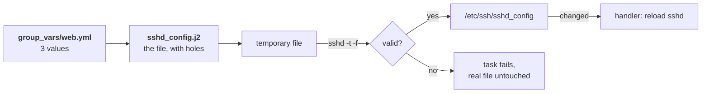

# Lab A7: Templates, handlers and validate

In [Lab M7](labM7.md) you hardened `sshd` by hand and saw how one typo could lock you out. Here Ansible does the same job with a safety net built in: the new file is **tested before it replaces the real one**. You also move the three numbers into a variables file, so the template stays the same and only the data changes.

**Part 2: as a playbook, on branch a.** About 15 min. This is the same job you did by hand in [Lab M7](labM7.md).

Your pod number is the number in your login name (`student07` is pod 07). The page fills it in where you see it below; if you still see `@POD@`, use that number.

> **Starting here?** You need the web node reachable from Ansible (`ansible all -m ping` works).

---

## In this lab

| Concept or command | What it does |
| ------------------ | ------------ |
| `ansible.builtin.template` | Build a file from a `.j2` template and variables |
| `validate: 'sshd -t -f %s'` | Test the new file *before* it replaces the real one (`%s` is the temporary copy) |
| `notify:` and `handlers:` | Reload `sshd` only if the file changed |
| `group_vars/web.yml` | Variables for every host in the `web` group |
| `ansible ... -m command -a "sshd -T"` | Run one command on many hosts, to check the result |

---

## The idea: data, template, guard



Three pieces, each with one job:

- **data**: the three numbers, in `group_vars/web.yml`;
- **template**: the whole `sshd_config` with placeholders where those numbers go;
- **guard**: `validate:`, so a bad file never lands.

---

## 1. The variables

Create `~/netlab/group_vars/web.yml` (next to `all.yml`). There is an example in the starter folder you can copy:

```sh
cd ~/netlab
cp labs/4-templates-validate/web.yml.example group_vars/web.yml
cat group_vars/web.yml
```

```yaml
sshd_max_auth_tries: 3
sshd_login_grace_time: 20
sshd_x11_forwarding: "no"
```

The quotes around `"no"` matter. In YAML an unquoted `no` is the boolean *false*, and the template would write `X11Forwarding False`, which `sshd` rejects. Quoting makes it the text `no`.

---

## 2. The template

Open `labs/4-templates-validate/sshd_config.j2`. It already holds the lines you keep so you can log in. Replace the three `TODO` values with the variables:

```jinja
MaxAuthTries {{ sshd_max_auth_tries }}
LoginGraceTime {{ sshd_login_grace_time }}
X11Forwarding {{ sshd_x11_forwarding }}
```

`{{ name }}` is replaced by the variable's value when the file is built. Everything else is copied as is. The template is a **whole file**, not a patch like the `sed` and `printf` you used in Lab M7, which is why it is idempotent: the result is the same no matter what the file looked like before.

---

## 3. The play

In `labs/4-templates-validate/site.yml`, replace the placeholder task and handler:

```yaml
  tasks:
    - name: Harden sshd
      ansible.builtin.template:
        src: sshd_config.j2
        dest: /etc/ssh/sshd_config
        owner: root
        mode: "0600"
        validate: "sshd -t -f %s"
      notify: Reload sshd

  handlers:
    - name: Reload sshd
      ansible.builtin.command: sh -c 'kill -HUP $(cat /run/sshd.pid)'
```

- `validate:` makes Ansible write the new file to a **temporary** location and run `sshd -t -f <that file>` on it (`%s` stands for the path). Only if the test passes does the file replace `/etc/ssh/sshd_config`. This is Lab M7's `sshd -t -f /tmp/sshd_test`, run automatically on every change.
- The handler is Lab M7's `kill -HUP`, which reloads the configuration without dropping existing sessions. It runs once, at the end, and only when the file changed.

Run it twice:

```sh
ansible-playbook labs/4-templates-validate/site.yml
ansible-playbook labs/4-templates-validate/site.yml
```

First run: `changed`, plus the handler. Second run: `changed=0`, and no reload.

---

## 4. Prove it

```sh
ansible 'web:&auto' -m ansible.builtin.command -a "sshd -T"
ansible all -m ansible.builtin.ping
```

`sshd -T` prints a long list; look for `maxauthtries 3`, `logingracetime 20` and `x11forwarding no`. The `ping` confirms you can still log in. Add `| grep -Ei 'maxauthtries|logingracetime|x11forwarding'` to shorten the first.

---

## The twist: a typo that cannot hurt

Edit `group_vars/web.yml` and change one value to a typo, in place:

```sh
sed -i 's/^sshd_max_auth_tries:.*/sshd_max_auth_tries: three/' group_vars/web.yml
ansible-playbook labs/4-templates-validate/site.yml
```

**Your turn:** predict what the playbook does, and what state `sshd` is in afterwards.

<!-- dojo-reveal: What happened? -->

The task **fails** with a message from `sshd -t` (`MaxAuthTries integer value invalid`), and the handler does not run. The real `/etc/ssh/sshd_config` was never replaced, and `sshd` is still running with the good settings. `ansible all -m ping` still works.

By hand, the same typo in the live file would have been loaded at the next restart and could have locked you out of the node. `validate:` turns a dangerous change into a harmless failure. Use it for every file where a mistake could stop a service from starting (`sshd`, `sudoers`, `nginx.conf`).

<!-- /dojo-reveal -->

Fix the value (`sed -i 's/^sshd_max_auth_tries:.*/sshd_max_auth_tries: 3/' group_vars/web.yml`) and rerun: the recap returns to `changed=0`.

---

## Check your work

```sh
cd ~/netlab
dojo netlab check A7
```

It reads the effective `sshd` values on the web node and checks that you can still log in. Each line says `PASS` or `FAIL` with the reason. The checker allows about six runs a minute.

---

## If you are stuck

| You see | Cause and fix |
| ------- | ------------- |
| `'sshd_max_auth_tries' is undefined` | `group_vars/web.yml` is missing or in the wrong folder: it must be `~/netlab/group_vars/web.yml` |
| `validate` fails with `X11Forwarding False` | The value was not quoted: write `"no"` |
| `Unsupported option` or a `TODO` error | A `TODO` is still in `sshd_config.j2` |
| `ansible all -m ping` shows `UNREACHABLE` | The pod is still starting, or you changed `sshd` badly. Wait a minute, then `ansible-playbook reset_fw.yml -e branch=a` |
| Changes seem to be ignored | A value set twice: check `group_vars/web.yml` has each key once (see precedence in [Lab A5](labA5.md)) |

---

## Recap

- A **template** builds a whole file from variables; the data lives in `group_vars/`.
- **`validate:`** tests a file before it replaces the real one, so a typo fails the task instead of breaking the service.
- A **handler** reloads the service once, only if the file changed.
- Quote YAML values like `"no"` that would otherwise become booleans.
- `sshd -T` shows what is in force, not just what the file says.

**Next:** [Lab A8](labA8.md): lock the web server down, and test that it really is locked.
