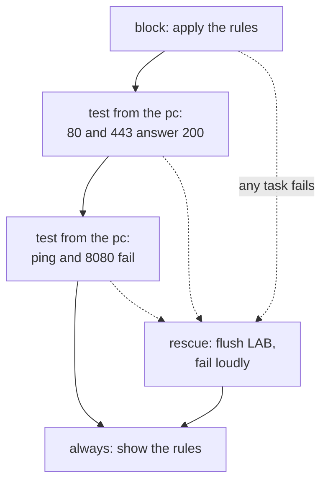

# Lab A8: Lock it down, test it, roll it back

In [Lab M8](labM8.md) you built the policy by hand: allow 80 and 443, drop ping, drop everything else. It worked, but there was no test built in and no undo. This lab writes the same policy as a playbook that **applies the rules, tests the result from the pc, and rolls back by itself if a test fails**. Real change work is mostly this: not the change, but knowing it worked and being able to undo it.

**Part 2: as a playbook, on branch a.** About 20 min. This is the same job you did by hand in [Lab M8](labM8.md).

Your pod number is the number in your login name (`student07` is pod 07). The page fills it in where you see it below; if you still see `@POD@`, use that number.

> **Starting here?** You need the web server serving HTTP and HTTPS on branch a (Labs A4 to A6) and `group_vars/fw.yml` from [Lab A5](labA5.md).

---

## In this lab

| Concept or command | What it does |
| ------------------ | ------------ |
| `block:` / `rescue:` / `always:` | Run tasks; if any fails run the rescue; always run the last part |
| `ansible.builtin.uri` + `retries`/`until` | Fetch a URL and wait for the right answer |
| `delegate_to:` | Run a task on a *different* host (here the pc) |
| `failed_when:` / `changed_when:` | Say what counts as failure or change for a command |
| `ansible.builtin.assert` | Fail with a message unless a condition holds |
| `serial: 1` | Work on one host at a time |

---

## The idea: change, test, undo



- **`block`** groups tasks. If any one fails, Ansible jumps to **`rescue`**.
- **`rescue`** is the undo. It must also *fail the play*, otherwise Ansible considers the problem handled and carries on as if nothing happened.
- **`always`** runs either way: here it prints the rules now in force, so you can see what state you were left in.
- The tests run from the **pc** (`delegate_to`), because that is the machine the policy is about. A rule you cannot demonstrate from the client is a rule you are only hoping works.

---

## 1. Open the starter

```sh
cd ~/netlab
```

Open `labs/6-lockdown/site.yml`. The play header gives you `serial: 1` and the variables `pc_net` and `pc_node`.

**Why `serial: 1`?** Ansible normally works on every host in the group at once. With `serial: 1` it finishes one firewall before it starts the next, so a bad change reaches one firewall and the play stops. In your pod there is only one, but the habit is the point.

---

## 2. TODO 1 and 2: the allow rules

Delete the `allowed_ports` line from `vars:` (it comes from `group_vars/fw.yml`, Lab A5). Inside the `block`, add the rules from Lab A5 again:

```yaml
        - name: Allow the web ports
          ansible.builtin.iptables:
            chain: LAB
            protocol: tcp
            source: "{{ pc_net }}"
            destination: "{{ web_ip }}"
            destination_port: "{{ item | string }}"
            jump: ACCEPT
          loop: "{{ allowed_ports }}"
          loop_control:
            label: "port {{ item }}"
```

The rules already exist from Lab A5, so these report `ok`. They are here so this playbook describes the **whole** policy and does not depend on an earlier lab having run.

---

## 3. TODO 3 and 4: drop ping, then drop the rest

```yaml
        - name: Drop ping inside LAB
          ansible.builtin.iptables:
            chain: LAB
            protocol: icmp
            jump: DROP

        - name: Drop everything else
          ansible.builtin.iptables:
            chain: LAB
            jump: DROP
```

Two reasons it is written this way, both from Lab M8:

- The baseline allows ping *after* `LAB`, so ping is only blocked by a drop rule **inside** `LAB`.
- The catch-all must be **last**. The module appends in the order the tasks run, so the order of these tasks is the order of the rules.

---

## 4. TODO 5: tests that must pass

```yaml
        - name: Web answers on HTTP from the pc
          ansible.builtin.uri:
            url: "http://{{ web_ip }}/"
            status_code: 200
          delegate_to: "{{ pc_node }}"
          register: http
          retries: 3
          delay: 2
          until: http.status == 200

        - name: Web answers on HTTPS from the pc
          ansible.builtin.uri:
            url: "https://{{ web_ip }}/"
            status_code: 200
            validate_certs: false
          delegate_to: "{{ pc_node }}"
          register: https
          retries: 3
          delay: 2
          until: https.status == 200
```

- `delegate_to: "{{ pc_node }}"` runs the task **on the pc**, so the request really travels pc, switch, firewall, web.
- `retries`/`until`/`delay` retry up to three times, two seconds apart. A rule or service can take a moment to take effect, and a test that fails on the first try for no reason teaches you to ignore failures.
- `validate_certs: false` is the `curl -k` of Lab M6: the certificate is self-signed.

---

## 5. TODO 6: tests that must fail

For things that should be *blocked*, success means the command **fails**. A failing command normally stops the play, so you tell Ansible not to treat it as a failure and assert on the result yourself:

```yaml
        - name: Ping from the pc must fail
          ansible.builtin.command: ping -c 1 -W 2 {{ web_ip }}
          delegate_to: "{{ pc_node }}"
          register: ping
          failed_when: false
          changed_when: false

        - name: Ping is blocked
          ansible.builtin.assert:
            that: ping.rc != 0
            fail_msg: "Ping got through: the ICMP drop is not working"
          when: not ansible_check_mode

        - name: Port 8080 from the pc must fail
          ansible.builtin.command: curl -s -m 3 http://{{ web_ip }}:8080/
          delegate_to: "{{ pc_node }}"
          register: p8080
          failed_when: false
          changed_when: false

        - name: Port 8080 is blocked
          ansible.builtin.assert:
            that: p8080.rc != 0
            fail_msg: "Port 8080 got through: the catch-all drop is not working"
          when: not ansible_check_mode
```

`failed_when: false` stops the failing `ping` from ending the play; `assert` then checks the exit code. `changed_when: false` stops it from showing as a change (it only looks). The `fail_msg` is what you read when the test breaks, so say what it means, not just that it failed. `when: not ansible_check_mode` keeps a `--check` preview (Lab A9) from failing: in check mode the `ping` and `curl` are skipped, so there is no result to assert on.

---

## 6. TODO 7: the rollback

Replace the `rescue` placeholder:

```yaml
      rescue:
        - name: Flush LAB (roll back)
          ansible.builtin.command: iptables -F LAB

        - name: Report the rollback
          ansible.builtin.fail:
            msg: "Lockdown failed a test and was rolled back: LAB is empty again"
```

`iptables -F LAB` is the undo you would have scrambled to type in Lab M8. It empties only the `LAB` chain: the baseline rules around it stay. Then `fail:` makes sure the play ends **red**, so nobody reads a rolled-back run as a success.

Remove the placeholder tasks, then run:

```sh
ansible-playbook labs/6-lockdown/site.yml
ansible-playbook labs/6-lockdown/site.yml
```

The first run shows `changed` for the ICMP and catch-all rules, the four tests `ok` or passing, and the `always` part printing the rules. The second run is `changed=0`.

---

## 7. Prove it, from the pc

```sh
ansible-playbook probe.yml -e branch=a -e expect=allowed
ansible-playbook probe.yml -e branch=a -e port=443 -e expect=allowed
ansible-playbook probe.yml -e branch=a -e port=8080 -e expect=blocked
ansible-playbook probe.yml -e branch=a -e proto=icmp -e expect=blocked
```

All four should say `PASS`. The playbook already tested the same things, so these are a second opinion from a different tool: if they disagree, believe the probe and find out why the playbook's test was too weak.

---

## The twist: break it on purpose

Stop nginx on the web node and run the playbook again:

```sh
ansible 'web:&auto' -m ansible.builtin.command -a "nginx -s stop"
ansible-playbook labs/6-lockdown/site.yml
```

**Your turn:** which task fails, what happens next, and what state is the firewall in at the end?

<!-- dojo-reveal: What happens? -->

The HTTP test fails (after three tries), the rest of the block is skipped, `rescue` flushes `LAB` and `fail` ends the play red. The `always` section prints an **empty** chain: the firewall is back to the baseline, not half locked down. The `fail_msg`/`rescue` message tells you what happened.

Notice the playbook was right to fail. The firewall rules were fine; the *service* was down. A test from the client's side cannot tell the two apart, which is why a good error message and a look at the counters matter when you debug. Start nginx again (`ansible 'web:&auto' -m ansible.builtin.command -a "nginx"`) and rerun: it applies cleanly.

<!-- /dojo-reveal -->

---

## Check your work

```sh
cd ~/netlab
dojo netlab check A8
```

This runs the lockdown checks (ports 80 and 443 allowed; 8080, 22 and ping blocked) and also tests it **from an attacker's point of view**, from the pc. Each line says `PASS` or `FAIL` with the reason. The checker allows about six runs a minute.

---

## If you are stuck

| You see | Cause and fix |
| ------- | ------------- |
| The play ends red with "rolled back" | A test failed. Read the line above it, fix that cause (often nginx not running), and rerun |
| `'allowed_ports' is undefined` | `group_vars/fw.yml` from Lab A5 is missing, or you removed it |
| Ping still works | The ICMP drop is *after* the baseline's allow, or missing: it must be inside `LAB` |
| A rule is in the wrong order | The module only appends: `ansible-playbook reset_fw.yml -e branch=a` and apply again |
| `ansible all -m ping` shows `UNREACHABLE` | The pod is still starting. Wait a minute, then `ansible-playbook reset_fw.yml -e branch=a` |
| Everything on branch a is blocked after a mistake | `ansible-playbook reset_fw.yml -e branch=a`, then re-apply Labs A4 to A7 |

---

## Recap

- A change worth making is worth **testing and undoing**: `block` applies it, `rescue` undoes it, `always` reports.
- `rescue` must end with `fail`, or the failure is treated as handled.
- Test from the **client's side** (`delegate_to`), and write tests for what must be blocked as well as what must work.
- `assert` turns a result into a pass or a clear failure message.
- `serial: 1` limits the blast radius of a bad change.

**Next:** [Lab A9](labA9.md): rebuild the whole thing from a clean start and prove it matches your hand-built version.
