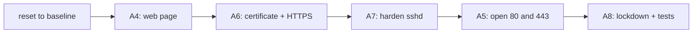

# Lab A9: Capstone: from clean to done

In [Lab M9](labM9.md) you reset branch m and rebuilt it by hand, and wrote down how long it took and how many commands. Now you do the same to **branch a**, with one command, and prove the two branches ended up identical. This is the whole case for automation in one lab: the same result, repeatable, in seconds, with a preview and a test.

**Part 2: as a playbook, on branch a.** About 20 min. This is the same job you did by hand in [Lab M9](labM9.md).

Your pod number is the number in your login name (`student07` is pod 07). The page fills it in where you see it below; if you still see `@POD@`, use that number.

> **Starting here?** You need Labs A4 to A8 working: their playbooks are the building blocks of this one. Keep the numbers you wrote down in Lab M9.

---

## In this lab

| Concept or command | What it does |
| ------------------ | ------------ |
| `ansible-playbook reset_fw.yml -e branch=a` | Put branch a's firewall and web node back to the baseline |
| `import_playbook:` | Run another playbook as part of this one, in order |
| `ansible-playbook site.yml --check --diff` | Preview the whole rebuild |
| `ansible-playbook compare.yml` | Compare branch m (by hand) with branch a (by playbook) |
| `dojo check capstone` | Confirm you have passed every core lab |

---

## The idea: one entry point

Over Labs A4 to A8 you wrote five playbooks, each a piece of the final state. A capstone does not rewrite them; it **composes** them into one `site.yml` that builds everything in the right order. Order is the one thing that needs thought:



The web server comes **first** and the lockdown **last**, because the lockdown's tests fetch the page over HTTP and HTTPS from the pc. If the firewall closed before the web server was serving, the tests would fail for the wrong reason and the rollback would undo a good policy.

---

## 1. Throw branch a away

```sh
cd ~/netlab
ansible-playbook reset_fw.yml -e branch=a
ansible-playbook probe.yml -e branch=a -e expect=blocked
```

`reset_fw.yml` empties `LAB`, restores the baseline `FORWARD` rules, puts back nginx's default site and page, removes the certificate and restores the original `sshd_config`. It never touches the management login, so a bad rule cannot lock Ansible out. The switch from Labs A2 and A3 stays as it is. The probe should print `PASS` for "blocked": you are back at the start.

---

## 2. Write `site.yml`

Open `labs/8-capstone/site.yml`. Replace the placeholder play with imports, in the order from the diagram:

```yaml
- import_playbook: ../1-first-playbook/site.yml
- import_playbook: ../3-idempotency/site.yml
- import_playbook: ../4-templates-validate/site.yml
- import_playbook: ../2-variables-loops/site.yml
- import_playbook: ../6-lockdown/site.yml
```

- `import_playbook:` pulls the whole play in at the point you write it, and the paths are relative to this file. The lab folders keep their original names (`2-variables-loops` is Lab A5, and so on), so use the folder names, not the A-numbers.
- Nothing is copied: each building block stays in one place. If you fix the lockdown, the capstone picks the fix up.
- If you wrote the optional roles in Lab A11, you can call them instead of importing.

**Your turn:** why is "open 80 and 443" (Lab A5) listed *after* sshd and the certificate, and not first?

<!-- dojo-reveal: Does the order matter there? -->

For those two, not really: opening a port before the service exists is harmless, since nothing is listening yet. The order that **must** hold is "web server serving before the lockdown tests run". The rest is a sensible convention: configure the thing, then let traffic reach it. When the order does not matter, keep it in the order a person would explain it.

<!-- /dojo-reveal -->

---

## 3. Preview, then build

Check mode first. On a clean branch it shows everything that **would** change, without changing anything:

```sh
ansible-playbook labs/8-capstone/site.yml --check --diff
```

Expect some tasks to be skipped or to look odd in check mode (a test cannot pass against a web server that does not have the change yet). That is normal: check mode shows intent, not results. Read the diff and notice you have a complete, reviewable description of what is about to happen. By hand, nobody gets that.

Now build for real, and time it:

```sh
time ansible-playbook labs/8-capstone/site.yml
```

---

## 4. Run it twice

```sh
ansible-playbook labs/8-capstone/site.yml
```

The second run must end with `changed=0` for every host. This is the proof that every building block is idempotent. If a task still says `changed`, it is the one without a guard: a `command` with no `creates:` or `changed_when:`.

---

## 5. Prove the result

```sh
ansible-playbook probe.yml -e branch=a -e expect=allowed
ansible-playbook probe.yml -e branch=a -e port=443 -e expect=allowed
ansible-playbook probe.yml -e branch=a -e port=8080 -e expect=blocked
ansible-playbook probe.yml -e branch=a -e proto=icmp -e expect=blocked
ansible 'web:&auto' -m ansible.builtin.command -a "sshd -T"
```

All four probes should say `PASS`, and `sshd -T` should show `maxauthtries 3`, `logingracetime 20`, `x11forwarding no`.

---

## 6. Do the two branches agree?

Branch m was built by your hands, branch a by your playbook. They should end in the same place:

```sh
ansible-playbook compare.yml
```

It reads each firewall's rules and each web server's nginx config (leaving out counters and comments) and prints `same` or `DIFFERENT`, listing the lines that are only in `m` or only in `a`.

<!-- dojo-reveal: If it says DIFFERENT -->

That is the most useful output in the workshop, not a failure of the lab. Each `only in m` or `only in a` line is a place where the hand-built and automated versions disagree: a rule you typed in a different order, a rule you forgot, a port left over from an experiment. Decide which side is right, then fix the other. The playbook is the one you can fix permanently.

<!-- /dojo-reveal -->

---

## The twist: your numbers

Reset branch a and run `site.yml` once more, timing it against what you wrote down in Lab M9:

| | Lab M9 (by hand) | Lab A9 (playbook) |
| --- | --- | --- |
| Time to rebuild | | |
| Commands typed | | |
| Mistakes or repeats | | |
| Can a colleague repeat it? | | |

The point is not that the playbook is faster to *write*; it was not. It is that the **second** rebuild costs one command, identical every time, with a preview and a test built in.

---

## The capstone

When Labs A1 to A8 and this one each pass, run:

```sh
dojo check capstone
```

It asks the checker which labs it last saw pass on your pod and names any it has not. Re-run `dojo netlab check A<n>` for those and try again.

---

## Check your work

```sh
cd ~/netlab
dojo netlab check A9
```

This checks the final state on branch a **and** that the two branches match. Each line says `PASS` or `FAIL` with the reason. The checker allows about six runs a minute.

---

## If you are stuck

| You see | Cause and fix |
| ------- | ------------- |
| `Could not find or access '../1-first-playbook/site.yml'` | Wrong path: the folders keep their old names (`1-first-playbook`, `2-variables-loops`, `3-idempotency`, `4-templates-validate`, `6-lockdown`) |
| The lockdown rolls back | The web server was not serving yet: check the order of the imports |
| The second run is not `changed=0` | A task without a guard: read which one reports `changed` |
| `compare.yml` shows `DIFFERENT` | See the answer in step 6; the lines say what differs |
| `dojo check capstone` names a missing lab | Run `dojo netlab check A<n>` for it, and fix what fails |
| Everything on branch a is blocked after a mistake | `ansible-playbook reset_fw.yml -e branch=a`, then run `site.yml` again |

---

## Recap

- A capstone composes the pieces you already tested; it does not rewrite them.
- **Order** matters where one step depends on another: serve first, lock down last.
- `--check --diff` previews a rebuild; running twice and seeing `changed=0` proves idempotency.
- `compare.yml` turns "I think they match" into a list of differences.
- The first build takes effort; every rebuild after that is one command.

**Next:** the optional [Lab A10](labA10.md) (secrets) and [Lab A11](labA11.md) (roles).
