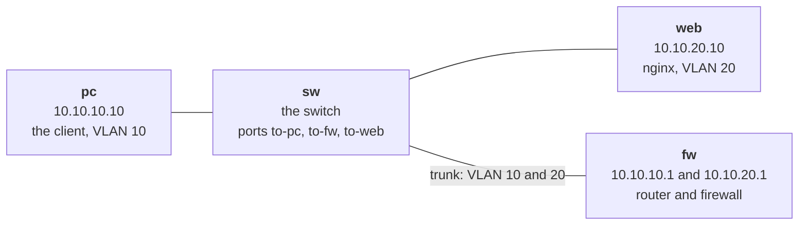

# Lab M1: Look around the pod

Before you change anything, find out what you are working with. In this lab you log in to each of the four nodes of your pod by hand and ask it questions: what addresses it has, where it sends traffic, what rules it enforces. Nothing here changes any setting, so you cannot break anything.

This is also the habit behind every later lab. **You can only automate something once you know what "normal" looks like.** The answers you collect here are exactly what an Ansible inventory and a few ad-hoc commands will fetch for you in [Lab A1](labA1.md).

**Part 1: by hand, on branch m.** About 10 min.

Your pod number is the number in your login name (`student07` is pod 07). The page fills it in where you see it below; if you still see `@POD@`, use that number.

---

## In this lab

| Command | What it does |
| ------- | ------------ |
| `ssh root@<node>` | Log in to a node over the network |
| `ip -br addr` | List the node's interfaces and addresses, one line each |
| `ip route` | Show where the node sends traffic |
| `iptables -S` | Print the firewall rules as commands |
| `bridge link` / `bridge vlan show` | List the switch's ports and which VLANs each carries |
| `ss -ltn` | List the TCP ports a node is listening on |
| `ping`, `curl` | Test whether one node can reach another |
| `ansible-playbook probe.yml` | Test the same thing from the pc, with a PASS or FAIL |

---

## The idea: one pod, two copies, four jobs

Your pod is a tiny office network. Every node is a small container with its own address and one job:



- **pc** is a client. It lives on the `10.10.10.0/24` network, which the switch calls **VLAN 10**.
- **web** is a web server on a different network, `10.10.20.0/24`, **VLAN 20**.
- **sw** is a switch. It connects the nodes with ports named `to-pc`, `to-web` and `to-fw`, and decides which ports belong to which VLAN.
- **fw** is a Linux firewall that also routes. The pc and the web server are on separate networks, so the firewall is the **only** way between them, and it decides what gets through.

The pod comes in two copies that start identical: **branch m** (m for manual, the one you configure by hand in Part 1) and **branch a** (a for automated, built with playbooks in Part 2). Node names say which: `role-branch-pod`, so `fw-m-@POD@` is the firewall of branch m in your pod.

---

## 1. Look at your workspace

Everything you run from your terminal starts in `~/netlab`. It holds the tools you will use for the whole workshop.

```sh
cd ~/netlab
ls
cat hosts.ini
```

`ls` shows the files: `hosts.ini` (the inventory), `probe.yml`, `compare.yml`, `reset_fw.yml`, `reset_switch.yml`, `verify_topology.yml` and a `labs/` folder. `hosts.ini` is an **inventory**: a list of every node, grouped by branch (`[manual]`, `[auto]`) and by role (`[pc]`, `[sw]`, `[fw]`, `[web]`). You will not need it in Part 1, but it is what Ansible reads in Part 2, so it is worth seeing now.

**Your turn:** before you run it, predict how many nodes `hosts.ini` lists. Then count them.

<!-- dojo-reveal: How many nodes? -->

Eight: four roles on each of the two branches. The pc, sw, fw and web of branch m, and the same four of branch a.

<!-- /dojo-reveal -->

Now ask whether the whole pod is healthy:

```sh
ansible-playbook verify_topology.yml
```

This playbook logs in to every node and checks its job (is forwarding on, does the switch have its VLANs, does nginx answer). A healthy pod prints green for every node. If a node is still starting, wait a minute and run it again.

---

## 2. Log in to a node

Every node takes the same root password. Your account keeps it in a file so you do not have to remember it:

```sh
cat ~/.config/dojo/netlab-password
ssh root@fw-m-@POD@
```

`ssh` opens a shell on another machine. Paste the password when it asks. You are now `root` on the firewall: the prompt changes and every command you type runs there, not on your own terminal. Type `exit` to come back.

> Why root with no `sudo`? These are throwaway lab containers. Logging in as root keeps the commands short, and it is the same login Ansible will use in Part 2.

---

## 3. Ask the firewall questions

On `fw-m-@POD@`, run these one at a time:

```sh
ip -br addr
```

`ip` is the Linux tool for network settings, and `-br` asks for a **b**rief one-line-per-interface view. You should see two VLAN interfaces, `eth1.10` with `10.10.10.1/24` and `eth1.20` with `10.10.20.1/24`. These are the firewall's two "legs", one in each network. They are **802.1Q subinterfaces**: one physical link that carries both VLANs, with each VLAN's traffic labelled (tagged) with its number. Lab M3 depends on this.

```sh
cat /proc/sys/net/ipv4/ip_forward
```

`1` means the kernel will pass traffic between its interfaces, i.e. it acts as a router. With `0` it would only accept traffic meant for itself.

```sh
iptables -S
```

`iptables -S` prints every firewall rule in the form you would type to create it. Read the output top to bottom:

```text
-P INPUT DROP
-P FORWARD DROP
-P OUTPUT ACCEPT
-N LAB
-A FORWARD -m conntrack --ctstate RELATED,ESTABLISHED -j ACCEPT
-A FORWARD -j LAB
-A FORWARD -p icmp -m icmp --icmp-type 8 -j ACCEPT
```

- `-P FORWARD DROP`: the **policy**. Traffic passing *through* the firewall is dropped unless a rule accepts it. That is why the web page does not load yet.
- `-N LAB`: a custom, empty chain (a named list of rules) called `LAB`.
- `-A FORWARD -j LAB`: every forwarded packet is sent through `LAB` first. **This is the chain you will add rules to in the labs.**
- the last rule accepts ping (ICMP type 8 is "echo request"), and it comes **after** `LAB`. That ordering matters in Lab M8.

**Your turn:** which kinds of traffic can currently cross the firewall from the pc to the web server? Decide before you read on.

<!-- dojo-reveal: What is allowed right now? -->

Only ping (echo requests), plus replies to connections already started (the `RELATED,ESTABLISHED` rule). Web traffic, SSH and everything else hit the `FORWARD DROP` policy.

<!-- /dojo-reveal -->

Type `exit` to leave the firewall.

---

## 4. Ask the switch questions

```sh
ssh root@sw-m-@POD@
bridge link
bridge vlan show
```

`bridge` is the iproute2 tool for Linux switching (bridges). `bridge link` lists the switch's ports, and `bridge vlan show` says which VLANs each port carries:

```text
port              vlan-id
to-web            20 PVID Egress Untagged
to-fw             10
                  20
to-pc             10 PVID Egress Untagged
br0               1 PVID Egress Untagged
```

Read it like this:

- `to-pc` is an **access port** in VLAN 10: `PVID` means untagged frames that arrive are put into VLAN 10, and `Egress Untagged` means frames leave without a VLAN label. The pc knows nothing about VLANs.
- `to-web` is the same for VLAN 20.
- `to-fw` is a **trunk**: it carries VLAN 10 **and** 20, tagged, so the firewall can tell them apart.

This is the working baseline. In Labs M2 and M3 you tear it down and rebuild it yourself. `exit` when done.

---

## 5. Ask the web server and the pc questions

```sh
ssh root@web-m-@POD@
nginx -v
ss -ltn
cat /var/www/html/index.html
```

`nginx -v` prints the nginx version, `ss -ltn` lists the TCP ports it is **l**istening on (**t**cp, **n**umeric), and the last command shows the page it serves. Expect ports 80 (the web server) and 22 (SSH). Exit, then try the pc:

```sh
ssh root@pc-m-@POD@
ping -c 1 10.10.20.10
curl -m 3 http://10.10.20.10/
```

`ping -c 1` sends one echo request. `curl -m 3` fetches the page but gives up after 3 seconds.

**Your turn:** one of these two works and the other does not. Which, and why? Think about what you read in the firewall rules.

<!-- dojo-reveal: Which works? -->

The ping works and the page does not. The firewall accepts ping (the last `FORWARD` rule) but has no rule for TCP port 80, so the `FORWARD DROP` policy silently drops it. `curl` waits until its 3-second limit.

<!-- /dojo-reveal -->

That mismatch is the starting point for the rest of the workshop: the web server is up, the network path works, and the firewall is the missing piece.

---

## Check it

Instead of typing `ping` and `curl` yourself, `probe.yml` runs them from the pc for you and prints PASS or FAIL against what you *expect*:

```sh
cd ~/netlab
ansible-playbook probe.yml -e branch=m -e proto=icmp -e expect=allowed
ansible-playbook probe.yml -e branch=m -e expect=blocked
```

- `-e` sets a variable. `branch=m` picks your hand-built pod, `proto=icmp` tests ping, and `expect=allowed` says what you believe should happen.
- The first should print `PASS` (ping goes through). The second tests HTTP and should also print `PASS`, because here you *expected* it to be blocked.

If you see `FAIL`, read the message: it says what actually happened.

---

## Recap

- A pod is four nodes, `pc`, `sw`, `fw` and `web`, in two copies (branch m and branch a).
- The **firewall** is the only route between VLAN 10 (pc) and VLAN 20 (web), and its `LAB` chain is where the labs add rules.
- `ip -br addr`, `iptables -S`, `bridge vlan show` and `ss -ltn` answer "what is this node doing?" without changing anything.
- At the start the pod allows ping and nothing else.
- Doing this once on one node is easy. Doing it on eight nodes, twice, is where automation pays off.

**Next:** [Lab M2](labM2.md): break the switch's VLANs on purpose, then rebuild them by hand.
