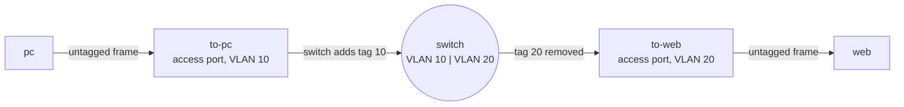

# Lab M2: VLANs and access ports

A switch connects many machines to one network. A **VLAN** (virtual LAN) lets one physical switch behave like several separate ones: machines in VLAN 10 can talk to each other but not to machines in VLAN 20, even though they are plugged into the same box. This lab rebuilds the VLAN setup on your switch by hand, port by port, so you know exactly what a "switch configuration" is made of.

The switch works at the start. You break it first, so you have something to build.

**Part 1: by hand, on branch m.** About 10 min. You will do this again as a playbook in [Lab A2](labA2.md).

Your pod number is the number in your login name (`student07` is pod 07). The page fills it in where you see it below; if you still see `@POD@`, use that number.

---

## In this lab

| Command | What it does |
| ------- | ------------ |
| `ansible-playbook reset_switch.yml -e branch=m` | Put branch m's switch into a blank state (everything in VLAN 1) |
| `bridge vlan show` | Show which VLANs each switch port carries |
| `bridge vlan add dev <port> vid <n> pvid untagged` | Make a port an **access** port in VLAN *n* |
| `bridge vlan del dev <port> vid <n>` | Remove a port from VLAN *n* |
| `bridge -j vlan show` | The same table as JSON, which is what Ansible parses in Lab A2 |

---

## The idea: access ports and tags

A switch port can be in a VLAN in two ways:



- An **access port** belongs to exactly one VLAN. The machine plugged in does not know about VLANs: its frames arrive **untagged** and the switch decides which VLAN they join. This is what `pvid` (port VLAN id) means. On the way out the switch strips the tag again (`untagged`).
- A **trunk port** carries several VLANs at once, with each frame **tagged** by its VLAN number so the far end can tell them apart. That is Lab M3.

In this pod `to-pc` is an access port in VLAN 10, `to-web` an access port in VLAN 20, and `to-fw` the trunk to the router. The switch is one Linux bridge, `br0`, with VLAN filtering turned on; each port is a bridge port.

---

## 1. Break the switch (on purpose)

You will need something to fix. This playbook puts the switch of **branch m** into a blank state: every port in VLAN 1 only, no VLAN 10 or 20.

```sh
cd ~/netlab
ansible-playbook reset_switch.yml -e branch=m
ansible-playbook probe.yml -e branch=m -e proto=icmp -e expect=blocked
```

The probe should print `PASS`: you *expected* ping from the pc to the web server to be blocked, and it is. With every port in VLAN 1 the switch is one flat network. The pc and the web server sit on different IP networks and the firewall's tagged VLAN traffic has nowhere to go, so nothing can be routed between them.

(`ansible-playbook reset_switch.yml -e branch=m -e restore=true` puts the working configuration back, if you ever want to start over. Branch a is not touched: you break and rebuild it yourself in Lab A2.)

---

## 2. Look at the blank switch

```sh
ssh root@sw-m-@POD@
bridge vlan show
```

Every port, `to-pc`, `to-web` and `to-fw`, shows `1 PVID Egress Untagged`: they are all access ports in the default VLAN 1. That is a flat network with no separation.

**Your turn:** the target is `to-pc` in VLAN **10** and `to-web` in VLAN **20**, untagged, with VLAN 1 gone from both. Before you read the next step, write down the four commands you think you need (two `add`, two `del`), using the command table at the top.

---

## 3. Build the access ports

```sh
bridge vlan add dev to-pc vid 10 pvid untagged
bridge vlan del dev to-pc vid 1
bridge vlan add dev to-web vid 20 pvid untagged
bridge vlan del dev to-web vid 1
bridge vlan show
```

Taking them apart:

- `bridge vlan add dev to-pc vid 10 pvid untagged` joins `to-pc` to VLAN 10. `pvid` makes it the VLAN for untagged frames arriving from the pc, and `untagged` sends frames out without a tag.
- `bridge vlan del dev to-pc vid 1` removes the old VLAN 1 membership. **Without this step the port would still be in VLAN 1**, and an access port is supposed to be in exactly one VLAN.

The result should be:

```text
port              vlan-id
to-web            20 PVID Egress Untagged
to-fw             1 PVID Egress Untagged
to-pc             10 PVID Egress Untagged
br0               1 PVID Egress Untagged
```

`to-fw` is still in VLAN 1 because the trunk is Lab M3. Leave it alone.

**Your turn:** run `bridge vlan add dev to-pc vid 10 pvid untagged` a second time. Predict what happens.

<!-- dojo-reveal: What happens when you repeat it? -->

Nothing bad: it succeeds and the table is the same. This `add` is safe to repeat, which matters for automation. Removing a VLAN that is already gone is also harmless here. When a command can be repeated without changing the result, it is **idempotent**, and that property is the heart of Ansible.

<!-- /dojo-reveal -->

---

## 4. Does the pc reach the web server yet?

```sh
cd ~/netlab
ansible-playbook probe.yml -e branch=m -e proto=icmp -e expect=blocked
```

Still `PASS` (blocked). The pc is now in VLAN 10 and the web server in VLAN 20, correctly separated, but the only way between them is through the firewall and the trunk to it carries nothing yet. That is Lab M3.

> Notice how much you typed: four commands on one switch, in the right order, with nothing recording what you did. Lab A2 turns this into a table of ports and VLANs.

---

## Check it

Look at the switch yourself:

```sh
ssh root@sw-m-@POD@ bridge -j vlan show
```

`to-pc` should show VLAN 10 with flags `PVID` and `Egress Untagged`, and `to-web` the same for VLAN 20, and neither should list VLAN 1. (`-j` prints JSON, the format Ansible will parse in Part 2.)

---

## Recap

- A **VLAN** separates machines on one switch. An **access port** puts its machine in exactly one VLAN and hides the tags from it.
- `bridge vlan add ... pvid untagged` makes an access port; `bridge vlan del` removes a membership.
- Forgetting to remove VLAN 1 leaves the port in two VLANs, a classic misconfiguration.
- The commands are safe to repeat, which is what makes them automatable.

**Next:** [Lab M3](labM3.md): the trunk that carries both VLANs to the firewall.
