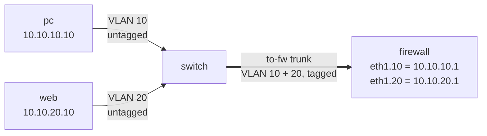

# Lab M3: Trunk and router-on-a-stick

After Lab M2 your access ports are right, but the pc still cannot reach the web server. The two machines are in different VLANs, which means different networks, and traffic between networks has to go through a **router**. In this pod the router is the firewall. This lab connects the switch to the firewall with a **trunk**, so that both VLANs can travel over one cable.

**Part 1: by hand, on branch m.** About 10 min. You will do this again as a playbook in [Lab A3](labA3.md).

Your pod number is the number in your login name (`student07` is pod 07). The page fills it in where you see it below; if you still see `@POD@`, use that number.

> **Starting here?** You need the blank switch and the two access ports from [Lab M2](labM2.md) first.

---

## In this lab

| Command | What it does |
| ------- | ------------ |
| `bridge vlan add dev to-fw vid <n>` | Let a port carry VLAN *n*, **tagged** (no `pvid`, no `untagged`) |
| `bridge vlan del dev to-fw vid 1` | Take the trunk out of the default VLAN |
| `ip -d link show` | On the firewall, show the VLAN subinterfaces in detail |
| `ip -o -4 addr show` | On the firewall, list its IPv4 addresses |
| `ping -c 1 <ip>` | Test that one node reaches another |

---

## The idea: router-on-a-stick

The firewall has **one** network cable to the switch, not two. Yet it must sit in both VLAN 10 and VLAN 20. The trick (nicknamed *router-on-a-stick*) is to carry both VLANs over the one cable, each frame labelled with its VLAN number (an **802.1Q tag**), and give the firewall a virtual interface for each:



A packet from the pc to the web server travels: pc, switch (access port, VLAN 10), trunk (tagged 10), firewall (arrives on `eth1.10`, is routed and leaves on `eth1.20`), trunk (tagged 20), switch, web. The pc and web use the firewall's address in their own network as their **default gateway**.

The firewall side is already done for you. You only have to make the switch's `to-fw` port a trunk.

---

## 1. Look at the firewall's side

```sh
ssh root@fw-m-@POD@
ip -d link show
ip -o -4 addr show
```

In the first output look for lines like `vlan protocol 802.1Q id 10` on `eth1.10` and `id 20` on `eth1.20`: these are the subinterfaces. The second shows `10.10.10.1/24` and `10.10.20.1/24`. Each address is the gateway for one VLAN. Type `exit`.

**Your turn:** the firewall will only ever receive tagged frames on its VLAN interfaces. So what should the switch's `to-fw` port do with the tags, strip them or keep them?

<!-- dojo-reveal: Strip or keep? -->

Keep them. The tag is how the firewall knows which VLAN a frame belongs to. So the trunk port gets `vid 10` and `vid 20` **without** `pvid` or `untagged`, which means "carry this VLAN with its tag left on".

<!-- /dojo-reveal -->

---

## 2. Build the trunk

```sh
ssh root@sw-m-@POD@
bridge vlan add dev to-fw vid 10
bridge vlan add dev to-fw vid 20
bridge vlan del dev to-fw vid 1
bridge vlan show
```

- The two `add` commands allow VLANs 10 and 20 on the port. There is no `pvid` and no `untagged`, so frames keep their tags.
- `del ... vid 1` removes the default VLAN, so the trunk carries only the two VLANs you intend. A trunk that quietly also carries VLAN 1 is a common way for traffic to leak where it should not.

You should see:

```text
port              vlan-id
to-web            20 PVID Egress Untagged
to-fw             10
                  20
to-pc             10 PVID Egress Untagged
br0               1 PVID Egress Untagged
```

Compare the two kinds of port. The access ports show `PVID Egress Untagged`; the trunk lists plain `10` and `20`. Type `exit`.

---

## 3. Test the whole path

```sh
ssh root@pc-m-@POD@
ping -c 1 10.10.20.10
```

You should see a reply. Ping crosses the switch, the trunk, the firewall and back out again. (The firewall's baseline allows ping, which is why this works while web traffic does not.)

If it fails, look for the usual causes: a typo in a VLAN id, `vid 1` still on a port, or the `bridge vlan show` table not matching the one above. Fix the table and ping again.

---

## Check it

```sh
cd ~/netlab
ansible-playbook probe.yml -e branch=m -e proto=icmp -e expect=allowed
```

`PASS` means the pc can reach the web server through your trunk.

---

## Recap

- Two VLANs are two networks, so crossing between them needs a router. Here the firewall is the router.
- A **trunk** carries several VLANs tagged over one link; an **access port** carries one VLAN untagged.
- *Router-on-a-stick* means one physical link, one virtual interface per VLAN (`eth1.10`, `eth1.20`).
- On a trunk, leave off `pvid` and `untagged`, and remove VLAN 1.

**Next:** [Lab M4](labM4.md): put a web page on the web server.
