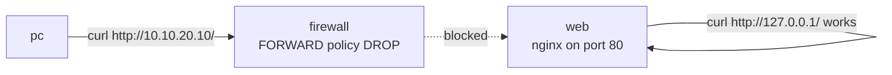

# Lab M4: Serve a web page

The simplest possible job: put your own page on the web server. It is small on purpose, because it lets you see two different questions that people often mix up: *is the service working?* and *can I reach it?* A web server can be perfectly healthy and still unreachable because a firewall sits in front of it.

**Part 1: by hand, on branch m.** About 10 min. You will do this again as a playbook in [Lab A4](labA4.md).

Your pod number is the number in your login name (`student07` is pod 07). The page fills it in where you see it below; if you still see `@POD@`, use that number.

> **Starting here?** The pc has to reach the web server's network, so finish [Lab M3](labM3.md) first. The pod's normal working state is the baseline from the end of M3.

---

## In this lab

| Command | What it does |
| ------- | ------------ |
| `cat /var/www/html/index.html` | Show the page nginx serves now |
| `echo '<html>' > <file>` | Write text to a file, replacing what was there |
| `curl -s <url>` | Fetch a URL and print the body (`-s` = no progress bar) |
| `curl -m 3 <url>` | Same, but give up after 3 seconds |
| `ansible-playbook probe.yml` | Test whether the pc can reach the page |

---

## The idea: two different questions



nginx serves files from a folder (its **document root**, `/var/www/html` here) and the file `index.html` is the page for `/`. When you test **from the web server itself** (`127.0.0.1` is "this machine") no firewall is involved, so it proves the **service** works. Testing **from the pc** also goes through the firewall, so it proves the **path** works. Today you will see one pass and the other fail, which is exactly right.

---

## 1. See the page that is there now

```sh
ssh root@web-m-@POD@
cat /var/www/html/index.html
```

You see a plain default page that names the node. That is what nginx serves for `/`.

---

## 2. Write your own

Replace it with a page that says something unmistakably yours. Use any text; the commands are the same:

```sh
echo '<h1>Hello from m</h1>' > /var/www/html/index.html
curl -s http://127.0.0.1/
```

- `echo '...'` prints the text and `>` **redirects** it into the file, replacing whatever was in it (`>>` would append instead).
- The quotes stop the shell from treating `<` and `>` as redirection.
- `curl -s http://127.0.0.1/` asks the local nginx for `/`. You should see your `<h1>` line straight away. There is no need to restart nginx: it reads the file each time it is asked.

**Your turn:** is the page on the *other* web server (branch a) changed? Predict, then check with `ssh root@web-a-@POD@ cat /var/www/html/index.html`.

<!-- dojo-reveal: Did branch a change? -->

No. The two branches are separate, isolated copies. You changed only the node you logged in to. That is the reason branch a exists: it lets a playbook do the same job somewhere else, and `compare.yml` shows whether the results match.

<!-- /dojo-reveal -->

---

## 3. Try from the pc

```sh
exit
ssh root@pc-m-@POD@
curl -m 3 http://10.10.20.10/
```

This should **hang for three seconds and print nothing**. The request reaches the firewall, matches no rule in `LAB`, and falls through to `-P FORWARD DROP`. A DROP gives no error message, just silence, which is why a firewall problem so often looks like "the server is down". The web server is fine; the firewall is correctly doing what it is configured to do. Lab M5 adds the missing rule.

---

## Check it

```sh
cd ~/netlab
ansible-playbook probe.yml -e branch=m -e expect=blocked
```

`PASS` means "HTTP is blocked from the pc, as you expected". If it prints `FAIL`, someone (you?) has already opened the port; reset with `ansible-playbook reset_fw.yml -e branch=m` and re-do the page.

---

## Recap

- `/var/www/html/index.html` is the page nginx serves; writing it changes the site immediately.
- Testing on the server proves the **service**; testing from another machine proves the **path**. Always know which one you are testing.
- A firewall DROP is silent: a timeout, not an error.
- Doing this on two web servers would be two sessions and two chances to mistype. Lab A4 does it once.

**Next:** [Lab M5](labM5.md): write the firewall rules that let the page through.
