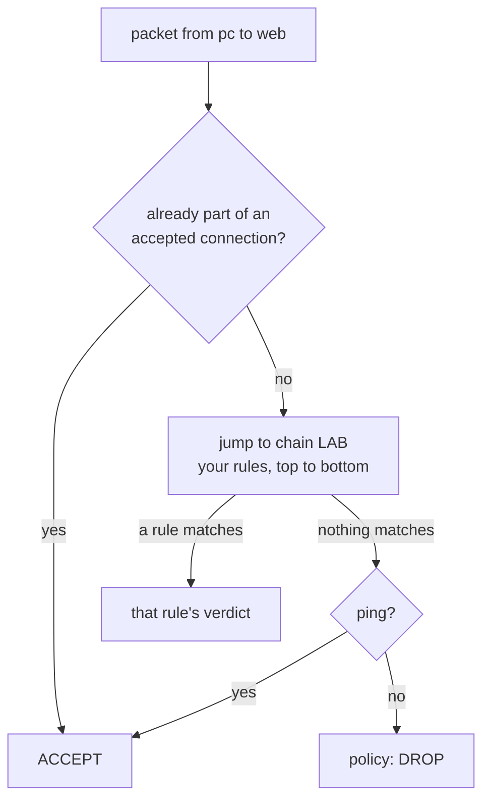

# Lab M5: Open HTTP and HTTPS

Your web page works but the firewall blocks it. In this lab you write the firewall rules that allow web traffic and nothing else. It is also your first real look at how a firewall thinks: rules are read in order, and the first match wins.

**Part 1: by hand, on branch m.** About 10 min. You will do this again as a playbook in [Lab A5](labA5.md).

Your pod number is the number in your login name (`student07` is pod 07). The page fills it in where you see it below; if you still see `@POD@`, use that number.

---

## In this lab

| Command | What it does |
| ------- | ------------ |
| `iptables -S LAB` | List the rules in the `LAB` chain as commands |
| `iptables -L LAB -n -v --line-numbers` | The same as a table with packet counters |
| `iptables -A LAB ...` | **A**ppend a rule to the end of the `LAB` chain |
| `iptables -F LAB` | **F**lush (empty) the chain |
| `ansible-playbook probe.yml` | Test from the pc whether traffic gets through |

---

## The idea: chains are lists, read top to bottom

iptables groups rules into **chains**. Every packet the firewall forwards is checked against `FORWARD`, and the baseline sends it into your own chain, `LAB`, on the way:



So the order is: *replies to existing connections*, then *your `LAB` rules*, then *the ping allow*, then the policy **DROP**. Anything that no rule accepts is dropped.

A good rule is as **specific** as it can be. You want "web traffic from the pc network to the web server", not "anything to port 80".

---

## 1. Write the rules

```sh
ssh root@fw-m-@POD@
iptables -A LAB -p tcp -s 10.10.10.0/24 -d 10.10.20.10 --dport 80 -j ACCEPT
iptables -A LAB -p tcp -s 10.10.10.0/24 -d 10.10.20.10 --dport 443 -j ACCEPT
iptables -S LAB
```

Reading the first rule piece by piece:

| Part | Meaning |
| ---- | ------- |
| `-A LAB` | append to the `LAB` chain |
| `-p tcp` | only TCP packets |
| `-s 10.10.10.0/24` | whose **source** is anywhere in the pc network |
| `-d 10.10.20.10` | and whose **destination** is the web server |
| `--dport 80` | going to **destination port** 80 (HTTP) |
| `-j ACCEPT` | **jump** to the verdict ACCEPT |

The second rule is the same for port 443 (HTTPS), which you will turn on in Lab M6.

**Why by address and not by interface name?** It is tempting to write `-i eth1.10`, but interface names differ between machines and runtimes. Addresses describe *what you mean* (this network, that server) and stay true everywhere. Ansible rules you write later use the same addresses.

`iptables -S LAB` should now show the two rules plus `-N LAB`:

```text
-N LAB
-A LAB -s 10.10.10.0/24 -d 10.10.20.10/32 -p tcp -m tcp --dport 80 -j ACCEPT
-A LAB -s 10.10.10.0/24 -d 10.10.20.10/32 -p tcp -m tcp --dport 443 -j ACCEPT
```

(iptables writes the address back as `/32`, "exactly this one host", and adds `-m tcp`. It is the same rule.)

---

## 2. Test from the pc

```sh
exit
ssh root@pc-m-@POD@
curl -m 3 http://10.10.20.10/
curl -m 3 http://10.10.20.10:8080/
```

The first should print your page. The second, port 8080, should time out: you never allowed it.

Now look at the counters on the firewall, which count how many packets each rule has matched:

```sh
exit
ssh root@fw-m-@POD@ iptables -L LAB -n -v --line-numbers
```

The `pkts` column for rule 1 is now above zero and rule 2 is still zero, because nothing has used HTTPS yet. Counters are the quickest way to see whether a rule is actually being hit.

**Your turn:** before you do it, predict what `curl -m 3 https://10.10.20.10/` does right now: connect, or fail? And is that the firewall's fault?

<!-- dojo-reveal: HTTPS right now -->

It fails, but **not** because of the firewall: rule 2 lets 443 through. The web server has nothing listening on 443 yet (its nginx has no HTTPS site), so the connection is refused. Lab M6 builds that.

<!-- /dojo-reveal -->

---

## Check it

```sh
cd ~/netlab
ansible-playbook probe.yml -e branch=m -e expect=allowed                 # port 80
ansible-playbook probe.yml -e branch=m -e port=8080 -e expect=blocked
```

Both should say `PASS`. Port 443 cannot be probed yet because nothing is listening; Lab M6 fixes that.

---

## Recap

- `LAB` is an ordered list; the first matching rule decides, and the policy DROP catches the rest.
- `-A` appends, `-S` prints rules as commands, `-L -n -v` shows counters.
- Match on **addresses and ports** (what you mean), not interface names.
- A packet counter that stays at zero means the rule is not being hit.
- *Typing the rule twice adds it twice.* Remember that for Lab A5: Ansible's `iptables` module checks first.

**Next:** [Lab M6](labM6.md): give the web server a certificate so HTTPS actually works.
