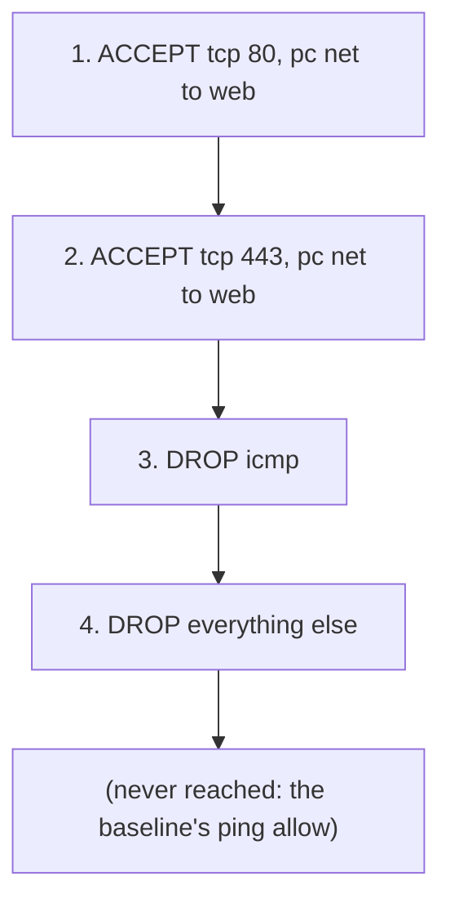

# Lab M8: Lock the server down

So far you have *opened* things. Security is as much about what stays closed. In this lab you build a **segmentation policy**: the pc network (VLAN 10) may reach the web server (VLAN 20) on exactly two ports, 80 and 443, and **everything else is dropped, including ping**. This is how real networks keep one zone from freely exploring another: a default of "no", with named exceptions.

**Part 1: by hand, on branch m.** About 15 min. You will do this again as a playbook in [Lab A8](labA8.md).

Your pod number is the number in your login name (`student07` is pod 07). The page fills it in where you see it below; if you still see `@POD@`, use that number.

> **Starting here?** You need the two web rules from [Lab M5](labM5.md) and the certificate from [Lab M6](labM6.md). Check what is in place with `ssh root@fw-m-@POD@ iptables -S LAB`.

---

## In this lab

| Command | What it does |
| ------- | ------------ |
| `iptables -S LAB` | Show the `LAB` chain as commands |
| `iptables -A LAB -p icmp -j DROP` | Append a rule dropping ping |
| `iptables -A LAB -j DROP` | Append a catch-all drop: the chain's "default no" |
| `iptables -L LAB -n -v --line-numbers` | Show the chain with packet counters and rule numbers |
| `iptables -F LAB` | Empty the chain (the undo) |
| `ansible-playbook probe.yml` | Test each case from the pc |

---

## The idea: order is the policy

Remember the path a forwarded packet takes: *existing connections*, then *your `LAB` chain*, then the baseline's **allow ping** rule, then the DROP policy. Two consequences:



- **Ping is still allowed after your rules**, because the baseline's ICMP allow sits *after* `LAB`. To forbid ping you must drop it **inside** `LAB`, ahead of that allow.
- A catch-all `DROP` at the end of `LAB` makes the closed state explicit. It is not strictly needed here because the `FORWARD` policy already drops, but a rule you can see (and count) is better than a default you have to remember.

**Order matters.** If you put the catch-all `DROP` first, the two ACCEPT rules would never be reached. Rules are read top to bottom, first match wins, so **specific allows go first and the catch-all goes last**.

---

## 1. Build the policy

You already have rules 1 and 2 from Lab M5. Add the other two:

```sh
ssh root@fw-m-@POD@
iptables -A LAB -p icmp -j DROP
iptables -A LAB -j DROP
iptables -S LAB
```

You should see, in this order:

```text
-N LAB
-A LAB -s 10.10.10.0/24 -d 10.10.20.10/32 -p tcp -m tcp --dport 80 -j ACCEPT
-A LAB -s 10.10.10.0/24 -d 10.10.20.10/32 -p tcp -m tcp --dport 443 -j ACCEPT
-A LAB -p icmp -j DROP
-A LAB -j DROP
```

If your list has a rule twice (because you typed it twice) or in a different order, empty the chain with `iptables -F LAB` and add the four rules again, in order.

**Your turn:** predict each result from the pc before you test: the page over HTTP, the page over HTTPS, ping, and `http://10.10.20.10:8080/`.

---

## 2. Test each case

```sh
exit
ssh root@pc-m-@POD@
curl -s -m 3 -o /dev/null -w '%{http_code}\n' http://10.10.20.10/
curl -ks -m 3 -o /dev/null -w '%{http_code}\n' https://10.10.20.10/
ping -c 1 -W 2 10.10.20.10; echo "ping exit code: $?"
curl -s -m 3 http://10.10.20.10:8080/; echo "8080 exit code: $?"
```

`-w '%{http_code}\n'` prints just the HTTP status; `-o /dev/null` throws the body away; `-k` accepts the self-signed certificate. You should get `200`, `200`, a ping timeout (exit code 1) and an 8080 timeout (exit code 28, curl's "timed out").

<!-- dojo-reveal: Check your predictions -->

HTTP and HTTPS return `200`, because rules 1 and 2 accept them before anything drops. Ping is dropped by rule 3, even though the baseline would allow it. Port 8080 hits only the catch-all in rule 4.

<!-- /dojo-reveal -->

Back on the firewall, look at the counters to see which rule actually handled which test:

```sh
exit
ssh root@fw-m-@POD@ iptables -L LAB -n -v --line-numbers
```

Rules 1 and 2 show packets from your `curl` calls, rule 3 shows the dropped ping, and rule 4 shows the 8080 attempt. This is how you prove a policy is doing what you think.

---

## 3. Feel the problem

A policy that works is one thing. A policy you have to *change safely* is another. Break something on purpose:

```sh
ssh root@web-m-@POD@
nginx -s stop
```

From the pc the page now fails. Is it the firewall or the server? Work it out: `ss -ltn` on the web node shows nothing on 80, and the firewall counters still show the packets arriving. The firewall passed them; nobody answered. Start nginx again with `nginx`.

Now the painful part. Imagine the lockdown had *caused* an outage and you had to undo it: could you type, from memory, the exact commands to return to the baseline, in the right order, on every firewall? Try: `iptables -F LAB` empties it, but you would then need to remember to re-add what you had before.

> That scramble, with no test and no undo, is exactly what a playbook with `block`/`rescue` replaces: it applies the rules, **tests** the result from the pc, and **rolls back** automatically if the test fails.

---

## Check it

```sh
cd ~/netlab
ansible-playbook probe.yml -e branch=m -e expect=allowed
ansible-playbook probe.yml -e branch=m -e port=443 -e expect=allowed
ansible-playbook probe.yml -e branch=m -e port=8080 -e expect=blocked
ansible-playbook probe.yml -e branch=m -e proto=icmp -e expect=blocked
```

All four should print `PASS`: HTTP and HTTPS allowed, port 8080 and ping blocked.

---

## Recap

- A segmentation policy is a **default deny** with explicit allows. Specific rules first, the catch-all last.
- The baseline's ping allow sits after `LAB`, so ping is controlled by a rule *inside* `LAB`.
- Counters (`-L -n -v`) show which rule handled which traffic: use them to prove a policy, not just to assume it.
- A timeout tells you *something* is dropping packets; the counters tell you *what*.
- The by-hand version has no test and no undo. Lab A8 adds both.

**Next:** [Lab M9](labM9.md): rebuild everything from a clean start, by hand.
